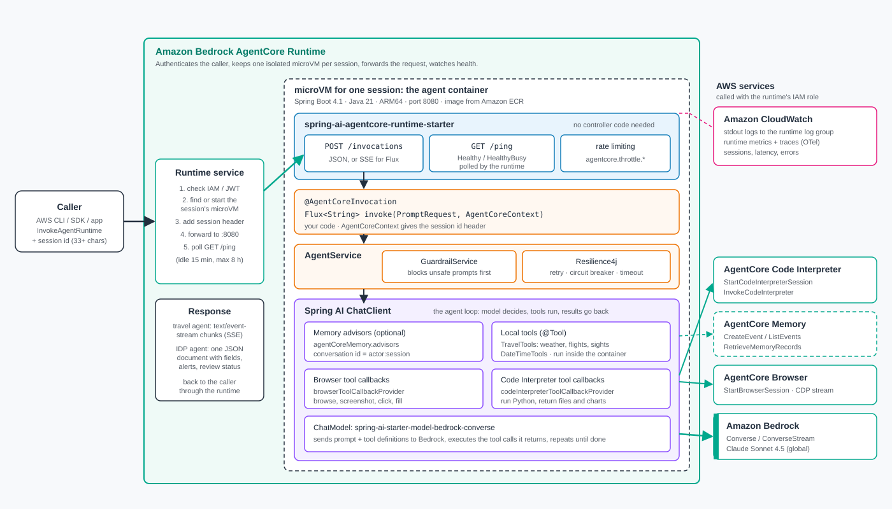
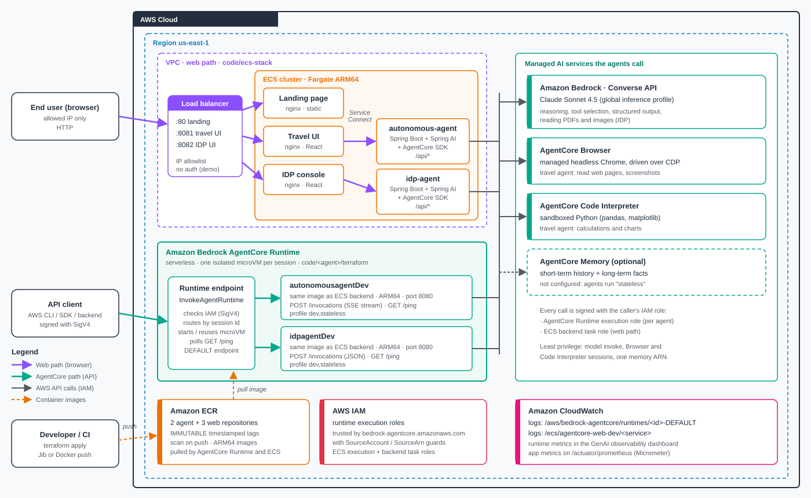

# Build Autonomous AI Agents with Amazon Bedrock and Spring AI (Java)

Companion repository for the AWS blog post of the same name. It contains the blog draft
and two runnable, production-grade examples built on **Amazon Bedrock**, **Spring AI**, and
the open-source [**Spring AI AgentCore**](https://github.com/spring-ai-community/spring-ai-agentcore) SDK.

## Contents

```
.
├── blog/
│   └── build-autonomous-ai-agents-with-amazon-bedrock-and-spring-ai.md
└── code/
    ├── autonomous-agent/    # Production-grade single agent: tools + memory + resilience + React UI
    └── idp-agent/           # Production-grade multi-agent IDP system + React UI
```

## Examples

### 1. `autonomous-agent`, single autonomous agent + UI
A production-grade travel-planning agent that shows the core pattern end to end: a single
`@AgentCoreInvocation` method, tool calling, AgentCore conversation memory, Resilience4j
circuit breaker + retry, domain metrics, a layered (`web`/`service`) design, and a React
streaming chat UI. A good first read. See
[code/autonomous-agent/README.md](code/autonomous-agent/README.md).

### 2. `idp-agent`, production-grade Intelligent Document Processing
A multi-agent IDP system with a React UI:

- **Multi-agent**: classifier routes to specialist agents (invoice, bank check, contract,
  ID, generic), each with its own prompt and tools.
- **File upload + agent selection** in the UI; the agent reads images/PDFs/text and can
  answer a question about the document.
- **Intelligent rules/workflow engine** (SpEL in `application.yml`) with **alerting**
  (e.g. "Check has no signature").
- **Observability** (Micrometer `@Observed`, domain metrics, Prometheus, structured logs),
  **resilience**, **12-factor config**, **graceful shutdown**.
- **Modular Terraform** (ecr / iam / agentcore-runtime / eks-app) with per-environment
  tfvars, deploy on **AgentCore Runtime** or an existing **Amazon EKS** cluster (IRSA).

See [code/idp-agent/README.md](code/idp-agent/README.md) and
[code/idp-agent/ui/README.md](code/idp-agent/ui/README.md).

## Architecture

Spring AI turns plain Spring beans into managed Amazon Bedrock AgentCore capabilities, no glue code:



Both examples build one ARM64 image, push it to Amazon ECR, and run it on a serverless AgentCore Runtime (the IDP agent can also run on Amazon EKS with IRSA):



More diagrams, including per-app architecture and the multi-agent flow, are in
[blog/diagrams/](blog/diagrams/README.md).

## Quick start (IDP)

```bash
cd code/idp-agent
export AWS_REGION=us-east-1
mvn spring-boot:run                 # backend on :8080
# in another terminal
cd ui && npm install && npm run dev # UI on :5173
```

Upload `code/idp-agent/samples/check-unsigned.txt` as a BANK_CHECK and watch the
missing-signature alert fire.

## Requirements

- Java 21+, Maven 3.9+, Node.js 20+
- AWS account with Amazon Bedrock model access enabled (Anthropic Claude models in your Region)
- For deployment: AWS CLI v2, Terraform >= 1.5, and a container engine that can build `linux/arm64` images (Docker with buildx, or an equivalent such as finch or podman)

## Deploy to AWS with Terraform

Both examples deploy the same way: they build an ARM64 container image, push it to Amazon ECR, and create an **Amazon Bedrock AgentCore Runtime** that runs that image. Terraform manages the ECR repository, the IAM execution role and policy, and the runtime itself. AgentCore Runtime is serverless, so there is nothing to keep warm and you are billed per use.

### After you clone: the exact path and commands

Say you cloned the repo to `~/bedrock-spring-ai-agentcore-blog`. Here is the whole flow for `autonomous-agent`. For `idp-agent`, use the same steps from `code/idp-agent` instead.

```bash
# 1. Go into the project you want to deploy
cd ~/bedrock-spring-ai-agentcore-blog/code/autonomous-agent

# 2. (Optional) review or edit the variables for the environment
#    File: terraform/environments/dev.tfvars   (see the table below)

# 3. Deploy. This runs terraform for you in the right order.
./scripts/deploy.sh dev
```

You run the command from the **project root** (`code/autonomous-agent`), not from inside `terraform/`. The script itself `cd`s into `terraform/` and runs `terraform init` and `terraform apply` for you, so you do not run those by hand.

### What is in the tfvars file and what to change

Each project keeps one variable file per environment under `terraform/environments/`:

- `code/autonomous-agent/terraform/environments/dev.tfvars` and `prod.tfvars`
- `code/idp-agent/terraform/environments/dev.tfvars` and `prod.tfvars`

The defaults work out of the box; every value already has a sensible default in `variables.tf`. You only edit the tfvars if you want to change something. Here is what each field means.

| Variable | Default | Change it when |
|---|---|---|
| `region` | `us-east-1` | You want to deploy to a different AWS Region. Make sure Bedrock model access is enabled there. |
| `environment` | `dev` (or `prod`) | Leave as-is; it matches the file name and drives naming, tags, and the Spring profile. Must be `dev`, `staging`, or `prod`. |
| `app_name` | `autonomous-agent` / `idp-agent` | You want different resource names. Lowercase letters, numbers, and hyphens only. |
| `image_tag` | `latest` | Almost never by hand. The deploy script sets a timestamped tag automatically after it pushes the image. |
| `memory_id` | `""` (empty) | You created an AgentCore Memory resource and want the agent to keep conversation history. Paste the id, or pass it as `AGENTCORE_MEMORY_ID` (see below). |
| `tags` | `CostCenter`, `Owner` | You want your own cost-allocation or ownership tags on every resource. |
| `bedrock_model` (autonomous-agent only) | `global.anthropic.claude-sonnet-4-5-...` | You want a different Claude model or inference profile. It must be enabled in your Region. |
| `ecr_kms_key_arn` (autonomous-agent only) | `""` (AWS-managed AES256) | You require customer-managed KMS encryption on the ECR repo. Provide a KMS key ARN. |

The most common real edit is just `region`, and `memory_id` if you want memory. For example, to deploy to Oregon with memory:

```hcl
# code/autonomous-agent/terraform/environments/dev.tfvars
region      = "us-west-2"
environment = "dev"
app_name    = "autonomous-agent"
image_tag   = "latest"
memory_id   = "mem-abc123def456"   # from scripts/create-memory.sh

tags = {
  CostCenter = "ml-platform"
  Owner      = "your-team"
}
```

You do not have to put the memory id in the file. The deploy script also reads it from an environment variable, which is handy for CI:

```bash
export AGENTCORE_MEMORY_ID=$(./scripts/create-memory.sh)
./scripts/deploy.sh dev
```

There is no backend or remote state to configure first. State is local by default (the S3 backend in `terraform/backend.tf` is commented out), so a fresh clone can deploy immediately.

### Prerequisites, once per machine

1. Install and configure the AWS CLI (see the AWS CLI setup notes in the chapter or the [official guide](https://docs.aws.amazon.com/cli/latest/userguide/getting-started-install.html)), then confirm your identity:

   ```bash
   aws sts get-caller-identity
   ```

2. Enable Amazon Bedrock model access for the Claude model you plan to use, in the same Region you deploy to (Bedrock console > Model access).

3. Install Terraform >= 1.5 and a container engine that builds `linux/arm64` images. The build-and-push script uses `docker buildx build --platform linux/arm64`. AgentCore Runtime runs ARM64, so an ARM64 image is required, not optional.

   ```bash
   terraform -version
   docker buildx version
   ```

The deployment scripts are written for bash. On Windows, run them from Git Bash or WSL, or run the equivalent steps by hand as shown below.

### Option A: one-command deploy (recommended)

Each project ships a `scripts/deploy.sh` that runs the three phases in the right order: create the ECR repository, build and push the image, then create the IAM role and AgentCore Runtime.

**autonomous-agent**

```bash
cd code/autonomous-agent

# Optional: create an AgentCore Memory resource first and capture its id
# so the agent keeps conversation history across turns.
export AGENTCORE_MEMORY_ID=$(./scripts/create-memory.sh)

# Deploy the dev environment (uses terraform/environments/dev.tfvars)
./scripts/deploy.sh dev
```

**idp-agent**

```bash
cd code/idp-agent
export AGENTCORE_MEMORY_ID=$(./scripts/create-memory.sh)   # optional
./scripts/deploy.sh dev
```

When it finishes, the script prints the runtime name and ARN.

### Option B: run the phases by hand

Useful when you want to see each step, or when running on Windows without bash. Commands shown for `autonomous-agent` in `us-east-1`; for `idp-agent` swap the directory and the `app_name`.

```bash
cd code/autonomous-agent/terraform

# 1. Initialize and create ONLY the ECR repository first, so there is
#    somewhere to push the image to.
terraform init -input=false
terraform apply -input=false -auto-approve \
  -var-file="environments/dev.tfvars" -var "memory_id=" \
  -target=module.ecr

# 2. Build the jar, log in to ECR, build and push the ARM64 image.
cd ..
mvn -q clean package -DskipTests
ACCOUNT_ID=$(aws sts get-caller-identity --query Account --output text)
REGION=us-east-1
REPO=autonomous-agent-dev
aws ecr get-login-password --region $REGION \
  | docker login --username AWS --password-stdin ${ACCOUNT_ID}.dkr.ecr.${REGION}.amazonaws.com
docker buildx build --platform linux/arm64 \
  -t ${ACCOUNT_ID}.dkr.ecr.${REGION}.amazonaws.com/${REPO}:latest --push .

# 3. Create the IAM role and the AgentCore Runtime pointing at that image.
cd terraform
terraform apply -input=false -auto-approve \
  -var-file="environments/dev.tfvars" -var "memory_id=" -var "image_tag=latest"
```

### Validate the deployment on AWS

After a successful apply, confirm each piece exists and works.

```bash
cd code/autonomous-agent/terraform

# Terraform's own view of what it created
terraform output

# 1. The ECR image is present
aws ecr describe-images \
  --repository-name autonomous-agent-dev \
  --query 'imageDetails[].imageTags' --output json

# 2. The AgentCore Runtime is READY
RUNTIME_ID=$(terraform output -raw runtime_id)
aws bedrock-agentcore-control get-agent-runtime \
  --agent-runtime-id "$RUNTIME_ID" \
  --query 'status' --output text        # expect READY

# 3. Invoke the runtime with a test prompt (data plane)
RUNTIME_ARN=$(terraform output -raw runtime_arn)
aws bedrock-agentcore invoke-agent-runtime \
  --agent-runtime-arn "$RUNTIME_ARN" \
  --payload '{"prompt":"Plan a 3-day trip to Tokyo"}' \
  response.json
cat response.json
```

For `idp-agent`, use the same commands from `code/idp-agent/terraform` with repository `idp-agent-dev`, and send a document-style prompt.

You can also watch runtime logs in CloudWatch Logs (log group `/aws/bedrock-agentcore/<runtime-name>`) and check metrics in the CloudWatch console.

### Environments

Each project has per-environment variable files under `terraform/environments/` (`dev.tfvars`, `prod.tfvars`). The scripts use a Terraform workspace per environment, so `dev` and `prod` keep separate state. Deploy prod with `./scripts/deploy.sh prod`, and review the plan carefully before applying to a production account.

### idp-agent on Amazon EKS (optional)

`idp-agent` can also run on an existing Amazon EKS cluster with IRSA instead of AgentCore Runtime. The hardened example lives in `code/idp-agent/terraform/examples/eks`, with `scripts/deploy-eks.sh` and `scripts/cleanup-eks.sh`. See [code/idp-agent/terraform/README.md](code/idp-agent/terraform/README.md). An EKS cluster costs money the whole time it runs, so treat that path as a longer-lived deployment and clean it up when done.

### Clean up to avoid charges

Tear everything down when you are finished. Each project has a cleanup script, or you can run Terraform destroy directly.

```bash
# autonomous-agent
cd code/autonomous-agent
./scripts/cleanup.sh dev
# or, by hand:
cd terraform && terraform destroy -var-file="environments/dev.tfvars" -var "memory_id="

# idp-agent
cd code/idp-agent && ./scripts/cleanup.sh dev
```

If you created an AgentCore Memory resource, delete it too (the cleanup scripts handle this when `AGENTCORE_MEMORY_ID` is set). ECR repositories can hold images that incur small storage charges, so confirm they are removed.

> Note on ARM64: AgentCore Runtime runs `linux/arm64`. The image must be built for that architecture. On an x86 machine, `docker buildx` handles the cross-build; make sure buildx and QEMU emulation are available (`docker buildx create --use` once, if needed).

## Related

- AWS blog: [Spring AI SDK for Amazon Bedrock AgentCore is now Generally Available](https://aws.amazon.com/blogs/machine-learning/spring-ai-sdk-for-amazon-bedrock-agentcore-is-now-generally-available/)
- [Spring AI AgentCore SDK](https://github.com/spring-ai-community/spring-ai-agentcore)

## License

Apache License 2.0. Code builds on the Spring AI AgentCore project (Apache 2.0).
