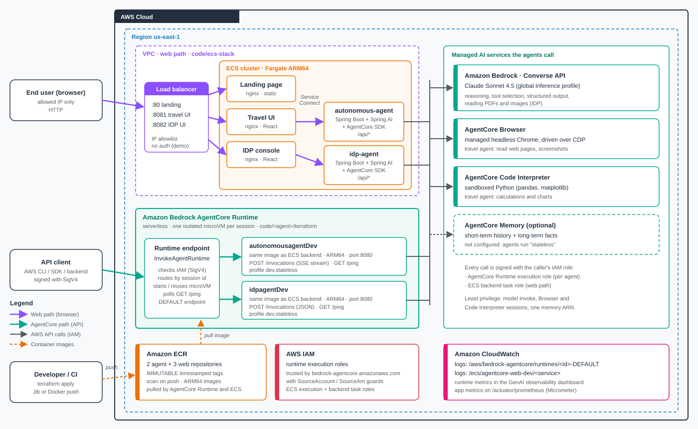
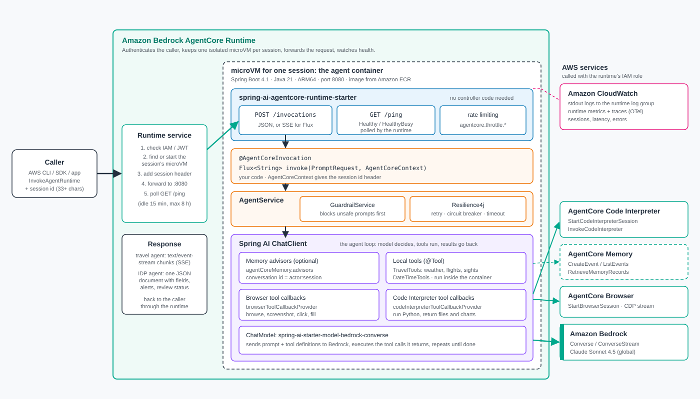

# Architecture: how the Spring AI agents run on Amazon Bedrock AgentCore

A plain-language guide to what is deployed, how a request flows, and what
AgentCore Runtime does versus what the Spring AI AgentCore SDK does. It ends with a
best-practice review of this sample.

## The short version

- Each agent is an ordinary **Spring Boot app** packaged as one ARM64 container image.
- **AgentCore Runtime** is AWS's serverless host for that container. You call it with the
  `InvokeAgentRuntime` API. It checks who you are, gives each conversation (session) its own
  isolated small VM, and forwards your request to the container.
- The **Spring AI AgentCore SDK** is the glue inside the container. Add the starter, put
  `@AgentCoreInvocation` on one method, and the app speaks AgentCore's contract
  (`POST /invocations`, `GET /ping`) with no controller code.
- Inside that method, **Spring AI's ChatClient** runs the agent loop. It asks Amazon Bedrock
  (Claude) what to do, runs tools (local `@Tool` methods, AgentCore Browser, AgentCore
  Code Interpreter), and repeats until it has an answer.

## Where is AgentCore Runtime when we build and deploy?

AgentCore Runtime is **not inside the Spring Boot app**, and you don't install or build it.
It is a managed AWS service, like AWS Lambda. Each side has one job:

| Piece | What it is | Who provides it |
|---|---|---|
| **AgentCore Runtime** (the host) | AWS service that runs your container in per-session microVMs, authenticates callers, and exposes `InvokeAgentRuntime` | AWS. Terraform *registers* your agent with it. |
| **Spring AI AgentCore SDK** (the adapter) | A Maven dependency, `spring-ai-agentcore-runtime-starter`, compiled into the jar. It makes the app answer `POST /invocations` and `GET /ping` the way the Runtime expects. | You, in `pom.xml` |
| **Your agent code** | The `@AgentCoreInvocation` method, `ChatClient`, tools, and rules | You |

Think of it like a web server and a hosting platform: the SDK makes the app *speak*
AgentCore, and the Runtime is the place AWS *runs* it.

### What the build and deploy actually do

`scripts/deploy.sh dev` runs three phases:

```
1. terraform apply -target=module.ecr   → creates the ECR repository (an empty image registry)
2. scripts/build-and-push.sh            → mvn builds the jar (SDK included), packages an
                                          ARM64 container image, pushes it to ECR
3. terraform apply                      → creates the IAM execution role and the
                                          AgentCore Runtime that points at that image
```

Phase 3 creates the runtime. This is the Terraform resource
(`terraform/modules/agentcore-runtime/main.tf`):

```hcl
resource "aws_bedrockagentcore_agent_runtime" "this" {
  agent_runtime_name = var.runtime_name          # autonomousagentDev
  role_arn           = var.role_arn              # IAM role the agent runs as
  agent_runtime_artifact {
    container_configuration {
      container_uri = var.image_uri              # <account>.dkr.ecr.<region>.amazonaws.com/autonomous-agent-dev:<tag>
    }
  }
  network_configuration { network_mode = "PUBLIC" }
  environment_variables = { ... }                # AWS_REGION, BEDROCK_MODEL, SPRING_PROFILES_ACTIVE, ...
}
```

It is a **definition, not a server**. Terraform tells AWS: "this is an agent called
`autonomousagentDev`, run this image with this role and these environment variables."
After `apply`, AWS shows the runtime as `READY`, but nothing is running and nothing is
billed yet. AWS also creates a `DEFAULT` endpoint, the address `InvokeAgentRuntime` calls.

This is what Terraform manages in this repo, per agent:

| Terraform resource | AWS object |
|---|---|
| `module.ecr.aws_ecr_repository.this` | ECR repository `autonomous-agent-dev` |
| `module.iam.aws_iam_role.this` + `aws_iam_role_policy.this` | Execution role the runtime assumes |
| `module.runtime.aws_bedrockagentcore_agent_runtime.this` | AgentCore Runtime `autonomousagentDev` (+ AWS-created `DEFAULT` endpoint) |

### What happens at run time

- **First `InvokeAgentRuntime` with a new session id:** AgentCore pulls the image from ECR,
  starts a microVM, and runs `java -jar` on port 8080. It waits for `GET /ping` to answer,
  then forwards the request to `POST /invocations`. This is the cold start. For a Spring Boot
  app it is mostly JVM and Spring startup, typically tens of seconds, so reuse session ids
  for follow-up turns.
- **More calls with the same session id:** they reach the same running microVM, so the app
  stays warm.
- **15 minutes idle, or 8 hours total:** AgentCore stops that microVM. You pay only for the
  CPU and memory used while sessions run.
- **New image or new settings:** change `image_tag` or an environment variable and
  re-apply. Terraform updates the runtime, AgentCore creates a new **version** (this
  deployment is on version 2 after one image update), and `DEFAULT` moves to it. New
  sessions use the new version.

### Same idea in Python

If you know the Python **Bedrock AgentCore SDK**, it is the same model. Only the
language and the packaging tool change.

| | Python | Java (this repo) |
|---|---|---|
| SDK that serves the Runtime contract | `bedrock-agentcore` (`BedrockAgentCoreApp`) | `spring-ai-agentcore-runtime-starter` |
| Mark the entry point | `@app.entrypoint` on a function | `@AgentCoreInvocation` on a Spring bean method |
| Request context (session id, headers) | `context` argument | `AgentCoreContext` argument |
| Streaming | `yield` from the entry point (async generator) | return `Flux<String>` |
| Health and background work | `/ping` built in; `@app.async_task` gives `HealthyBusy` | `/ping` built in; `AgentCoreTaskTracker` gives `HealthyBusy` |
| Server it starts | Uvicorn/Starlette on `:8080` | Embedded Tomcat on `:8080` |
| Agent framework inside | Strands, LangGraph, CrewAI, ... | Spring AI `ChatClient` |
| Packaging | CodeZip (zip to S3) or container | Container image (ARM64) in ECR |
| Who creates the Runtime | `agentcore deploy` (AgentCore CLI, uses AWS CDK) | `terraform apply` (`aws_bedrockagentcore_agent_runtime`) |
| Invoke it | `agentcore invoke` or `InvokeAgentRuntime` | `aws bedrock-agentcore invoke-agent-runtime` or `InvokeAgentRuntime` |

A minimal side-by-side:

```python
# Python
from bedrock_agentcore.runtime import BedrockAgentCoreApp
app = BedrockAgentCoreApp()

@app.entrypoint
def invoke(payload, context):
    return {"result": agent(payload["prompt"])}

app.run()   # serves /invocations and /ping on :8080
```

```java
// Java (Spring AI)
@AgentCoreInvocation
public Flux<String> invoke(PromptRequest request, AgentCoreContext context) {
    return chatClient.prompt().user(request.prompt()).stream().content();
}
// the runtime starter serves /invocations and /ping on :8080
```

In both languages the Runtime sees the same thing: a container on port 8080 that answers
`/invocations` and `/ping`. That shared contract is why AgentCore can host any framework
in any language. The AgentCore CLI scaffolds Python projects; for Java you build the
image yourself and create the runtime with Terraform, CloudFormation, the CDK, or the
`create-agent-runtime` API.

## Diagram 1: what is deployed



There are two ways in, and both use the **same container image** for each agent:

| | AgentCore path (teal) | Web path (purple) |
|---|---|---|
| Who uses it | Programs: AWS CLI, SDKs, other services | People in a browser |
| Front door | AgentCore Runtime `InvokeAgentRuntime` (IAM SigV4) | Load balancer, restricted to allowed IPs |
| Where the agent runs | AgentCore Runtime, one microVM per session | Amazon ECS Fargate, one long-running task |
| Agent endpoint used | `POST /invocations` | `/api/*` (the React UIs' endpoints) |
| Terraform | `code/autonomous-agent/terraform`, `code/idp-agent/terraform` | `code/ecs-stack` |

Why two paths? AgentCore Runtime only forwards `/invocations` and `/ping` to the
container, and every call must be signed (IAM or JWT). A browser can't sign IAM requests,
and the UIs call `/api/*`. So the web path runs the same images on ECS for the UIs. Both
paths call the same managed services with least-privilege IAM roles:

- **Amazon Bedrock**: the model (Claude Sonnet 4.5 through the global inference profile).
- **AgentCore Browser**: a managed Chrome the travel agent uses to read web pages.
- **AgentCore Code Interpreter**: a sandbox where the travel agent runs Python.
- **AgentCore Memory**: optional. It is not set up here, so both agents run with the
  `stateless` profile.

Images live in **Amazon ECR** with immutable, timestamped tags. Logs go to **CloudWatch**.

## Diagram 2: one request through AgentCore Runtime



What happens when you run
`aws bedrock-agentcore invoke-agent-runtime --runtime-session-id <id> --payload '{"prompt":"Plan a day in Tokyo"}'`:

1. **AgentCore Runtime checks the caller.** The request is signed with your IAM identity,
   and Runtime rejects it if you lack `bedrock-agentcore:InvokeAgentRuntime`.
2. **It picks the session's microVM.** The first call with a new session id starts a fresh,
   isolated microVM from the image in ECR. Later calls with the same id go to the same
   microVM. The session stops after 15 minutes idle, or 8 hours at most.
3. **It forwards the request** to the container on port 8080 as `POST /invocations`, adding
   the `X-Amzn-Bedrock-AgentCore-Runtime-Session-Id` header.
4. **The SDK's runtime starter receives it.** It turns the JSON into a `PromptRequest`, wraps
   the headers in `AgentCoreContext`, and calls the one method marked `@AgentCoreInvocation`.
   If that method returns `Flux<String>`, the starter streams the reply as Server-Sent Events.
5. **Your code runs.** `AgentService` screens the prompt (`GuardrailService`), then calls
   the model with retry, circuit breaker, and timeout (Resilience4j).
6. **Spring AI runs the agent loop.** `ChatClient` sends the prompt and the tool list to
   Amazon Bedrock. Claude replies "call `getWeather(Tokyo)`". Spring AI runs that tool and
   sends the result back, and this repeats until Claude writes the final answer. Tools can
   be local Java methods or AgentCore Browser and Code Interpreter sessions.
7. **The answer goes back** through Runtime to the caller. Meanwhile Runtime polls
   `GET /ping`. The SDK answers `Healthy`, or `HealthyBusy` while background work is
   tracked with `AgentCoreTaskTracker`, so Runtime does not stop a busy session.

### Who does what

| AgentCore Runtime (AWS) | Spring AI AgentCore SDK (in the container) | Your code |
|---|---|---|
| Authenticate callers (IAM / JWT) | Serve `/invocations` and `/ping` | One `@AgentCoreInvocation` method |
| One isolated microVM per session | JSON or SSE responses, rate limiting | Prompts, tools, business rules |
| Scale to zero, per-second billing | Health status (`Healthy` / `HealthyBusy`) | Guardrails and resilience choices |
| Logs, metrics, session lifecycle | Memory advisors, Browser and Code Interpreter tools | Which advisors and tools to wire |

## Is this AgentCore best practice?

The core is aligned with the AgentCore Runtime contract and the SDK's intended use. Some
choices are fine for a demo but should change for production.

**Aligned with best practice**

- **Runtime contract:** ARM64 image on port 8080, with `/invocations` and `/ping` served
  by the SDK rather than hand-written controllers.
- **Sessions:** session ids of 33+ characters come from the Runtime header through
  `AgentCoreContext`.
- **IAM:** a dedicated execution role per agent, with a trust policy guarded by
  `aws:SourceAccount` and `aws:SourceArn`. Permissions are scoped: model invoke (including
  global cross-Region inference), the Browser and Code Interpreter sessions the agent
  uses, and one memory ARN.
- **Images:** ECR with immutable tags and scan on push. Terraform refuses a tag that was
  never pushed.
- **No-memory mode:** the `stateless` profile gives a clean start without AgentCore Memory,
  rather than failing at boot.

**Gaps to fix before production**

| # | Gap | Why it matters | Recommended fix |
|---|---|---|---|
| 1 | The browser path runs the agents on ECS, not on AgentCore Runtime | The UIs don't get Runtime's session isolation or per-use pricing, and there are two copies to operate | Put a small backend-for-frontend behind the UIs that calls `InvokeAgentRuntime` with SigV4, or add a JWT (Cognito) authorizer so the frontend can call `/invocations` directly. Then retire the ECS backends. |
| 2 | No end-user authentication; the web path is HTTP and protected only by an IP allowlist | Fine for a quick check, not for real users | Use Amazon Cognito with a JWT authorizer on Runtime, an ACM certificate with HTTPS on the load balancer, and per-user authorization. |
| 3 | No AgentCore Memory | Each turn starts fresh, and the agents don't learn user preferences | Create memory with `scripts/create-memory.sh` and redeploy with `AGENTCORE_MEMORY_ID`. Build the conversation id as `<verified user id>:<session id>`, not the fixed `user:` prefix the code uses today. |
| 4 | The IDP review queue is kept in memory | On Runtime each session is its own microVM, so reviews don't persist or show across sessions. On ECS they're lost on restart. | Store review items in Amazon DynamoDB. |
| 5 | The travel agent waits for the full reply, then sends it in chunks | Users wait for the whole answer before seeing the first word | Move to `ChatClient.stream()` once multi-argument tool calls stream reliably in Spring AI. |
| 6 | Tracing is off (sampling 0) and there is no OpenTelemetry export | Runtime traces and CloudWatch GenAI observability show less detail | Enable OTel (ADOT) and CloudWatch Transaction Search, and set `TRACING_SAMPLING`. |
| 7 | Runtime uses `PUBLIC` network mode and the `DEFAULT` endpoint | No private networking and no versioned rollouts | Allow `VPC` mode in the Terraform module, and create named endpoints (for example `prod`) pinned to runtime versions. |
| 8 | Guardrails are a simple in-process check | Keyword checks miss a lot | Front the model with Amazon Bedrock Guardrails through an `ApplyGuardrail` advisor. |
| 9 | Terraform state is local | Anyone else applying would create duplicates | Enable the S3 backend with locking (commented out in `backend.tf`). |

## Clean up

These resources cost money while they exist, the ECS web stack the most (load balancer
plus five tasks). Remove them when you are done:

```bash
cd code/ecs-stack        && ./scripts/cleanup.sh dev   # web path
cd code/autonomous-agent && ./scripts/cleanup.sh dev   # AgentCore runtime
cd code/idp-agent        && ./scripts/cleanup.sh dev   # AgentCore runtime
```
