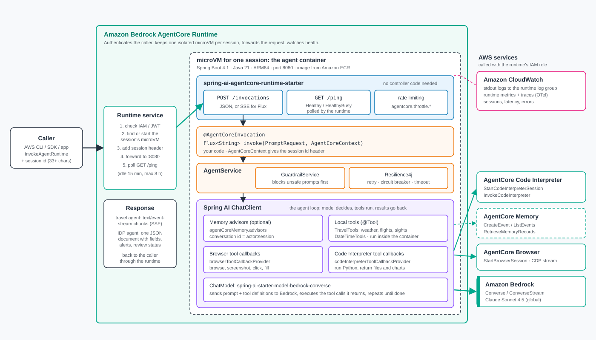
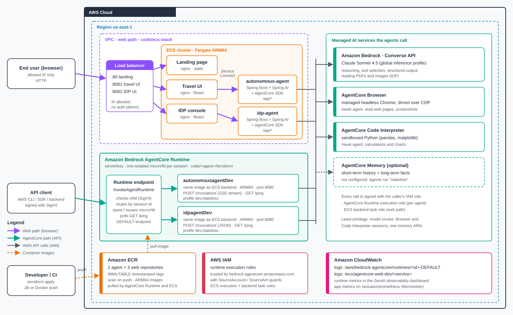

# Build autonomous AI agents with Amazon Bedrock and Spring AI

*By Viquar Khan and Mahammadali Saheb*

With Amazon Bedrock and Spring AI, Java teams can build autonomous AI agents that plan, call
tools and APIs, and keep context across multi-turn conversations. Agentic AI is moving beyond
prompt-response interactions toward autonomous systems that carry out complex, multi-step
tasks. Organizations across industries want these capabilities. Taking agents from prototype
to production, however, means addressing scalability, governance, security, and operational
concerns that agent frameworks don't solve by default.

Java remains one of the most widely used programming languages in enterprise software. Teams
have existing CI/CD pipelines, operational expertise, and established patterns built around
the JVM. Spring AI brings AI capabilities to the JVM through familiar Spring patterns:
auto-configuration, dependency injection, and composable advisors. Developers can build AI
agents with the same idioms they use for REST APIs, security, and data access.

With Amazon Bedrock AgentCore, you can build, deploy, and operate AI agents at scale. AgentCore
is framework-agnostic and model-agnostic: you bring your preferred agent framework and
foundation model. It provides the production infrastructure you need, including a managed
runtime, memory, browser automation, code execution, and identity management.

In this post, we show you how to build autonomous AI agents in Java using Spring AI, Amazon
Bedrock, and the Spring AI AgentCore SDK. We explore the key implementation patterns for two
systems. The first is a single-agent travel assistant that demonstrates tool calling and
memory. The second is a multi-agent intelligent document processing (IDP) system that shows
how specialist agents, a rules engine, and alerting work together.

## Prerequisites

To follow along with this walkthrough, you need the following:

- **Java** – JDK 21
- **Spring Boot** – 4.1, with Spring AI 2.0 and the Spring AI AgentCore SDK 2.0
- **Maven** – 3.9 or later
- **Node.js** – 20 or later (for the React frontends)
- **Terraform** – 1.6 or later
- **Docker** – with Buildx, to build `linux/arm64` images
- **AWS Command Line Interface (AWS CLI)** – v2, configured with credentials
- **An AWS account** with access to Anthropic Claude Sonnet 4.5 in Amazon Bedrock, in an AWS
  Region where Amazon Bedrock AgentCore is available

> **Note:** The [Spring AI AgentCore SDK GA announcement](https://aws.amazon.com/blogs/machine-learning/spring-ai-sdk-for-amazon-bedrock-agentcore-is-now-generally-available/)
> uses SDK 1.0 on Spring Boot 3.5. This post uses SDK 2.x, which targets Spring Boot 4.x and
> Spring AI 2.0. The programming model is the same.

## What makes a system an agent

Before diving into the implementation, it helps to define what distinguishes an agent from a
standard LLM application. An agent combines three capabilities:

- **Planning** – Given a goal, the model breaks it into steps, prioritizes them, and revises
  the plan as new information arrives.
- **Tool use** – Beyond generating text, the model selects and invokes external functions such
  as APIs, databases, and code interpreters to act in the world.
- **Memory** – Context carries across turns (short-term) and across sessions (long-term), so
  each decision builds on what came before.

A chat completion endpoint has none of these. A Retrieval Augmented Generation (RAG)
application has limited tool use (retrieval) but no planning loop. An agent has all three,
operating in a goal-directed loop until the task is complete or it determines it can't proceed.

The following diagram shows these capabilities in an end-to-end agentic pipeline, from request
to grounded answer.


*Figure 1: Agentic reference architecture. A request flows through the runtime, guardrails,
classification, a specialist agent, tools, the foundation model, memory, rules, and human
review to a grounded answer, with resilience and observability as cross-cutting concerns.*

The pipeline has 11 stages. A client submits a document and a question. The request enters
through AgentCore Runtime, which authenticates it, and input guardrails then screen for
harmful content. A classifier determines the document type and routes the request to a
specialist agent. The specialist plans its workflow and calls tools, the Amazon Bedrock
foundation model, memory, and a rules engine as needed. Low-confidence or flagged results go to
a human review queue before the grounded answer returns to the client. Resilience,
observability, logging, and least-privilege IAM apply across all stages.

## Solution overview

The solution consists of two deployable systems that share common patterns:

- **Travel assistant** – A single autonomous agent with tool calling (weather forecasts, flight
  price estimates, points of interest, and the current date and time), streaming responses,
  conversation memory, and resilience patterns. This is the recommended starting point.
- **IDP multi-agent system** – A multi-agent document processing platform with five specialist
  agents (Lawyer, Mortgage, Insurance, Tax, and General), a rules and workflow engine, alerting,
  and observability. It demonstrates production patterns at scale.

Both systems share the following architecture:

- A Spring Boot application with the Spring AI `ChatClient`, the Spring AI AgentCore SDK, and
  the Amazon Bedrock Converse API
- The AgentCore Runtime contract (`POST /invocations`, `GET /ping`) for managed deployment
- Conversation memory through AgentCore Memory (short-term and long-term)
- Tool calling with `@Tool` annotated methods
- Structured output mapped to Java records
- An ARM64 container image for AWS Graviton
- Modular Terraform for infrastructure provisioning

The following diagram shows how the travel assistant serves the AgentCore Runtime contract and
a React UI from one Spring Boot code base, while calling tools, streaming responses, and
reading and writing memory.


*Figure 2: Single-agent travel assistant. One Spring Boot application implements the AgentCore
Runtime contract and REST endpoints for the React UI, and calls Amazon Bedrock through the
Converse API.*

The travel assistant has two entry points in one application. The `/invocations` and `/ping`
contract serves AgentCore Runtime. REST endpoints under `/api` serve the React UI when you run
the application locally or on your own infrastructure. AgentCore Runtime forwards only the
contract paths to your container, so a browser client on the managed path calls
`/invocations` through a backend or an OAuth-protected endpoint. Spring AI orchestrates calls
to Amazon Bedrock through the Converse API and runs tool functions in process. AgentCore Memory
provides short-term and long-term context, so the agent retains history across sessions.

The following diagram shows the architecture for the IDP multi-agent system.


*Figure 3: IDP multi-agent system architecture. Specialist agents process documents through a
shared `ChatClient` pattern, with results flowing through a rules engine and alert service.*

The IDP system routes documents to five specialist agents, each built on a shared
`AbstractDocumentAgent` template. A `ClassifierAgent` reads each document and selects the
specialist, unless the caller specifies the agent type. The specialist extracts structured
JSON with confidence scores using the multimodal Amazon Bedrock Converse API. A rules engine
evaluates SpEL expressions from `application.yml` against the extraction. Rules with ALERT or
BLOCK severity dispatch through the `AlertService`, and low-confidence documents go to human
review. Metrics, an audit trail, resilience, and observability apply across all stages.

## Agent collaboration patterns

When multiple agents work together, how they coordinate determines system behavior. The
following diagram compares the three coordination patterns used in this solution.


*Figure 4: Agent collaboration patterns. The router dispatches each request to one specialist,
the evaluator passes findings through a rules engine, and the parallel fan-out sends one
request to several specialists and aggregates their results.*

- **Router pattern** – A lightweight orchestrator examines the incoming request and routes it
  to the right specialist. In the IDP system, the `ClassifierAgent` asks the model to classify
  the document's content and forwards it to the Lawyer, Mortgage, Insurance, Tax, or General
  agent. The router holds no domain logic. It is a dispatch layer only.
- **Evaluator pattern** – After a specialist returns its findings, a rules engine evaluates the
  output against configurable business rules. Rules that trigger ALERT or BLOCK severity
  dispatch through a pluggable `AlertService` for human review.
- **Parallel fan-out (optional extension)** – The base solution implements the router and
  evaluator patterns, and the batch endpoint processes documents sequentially. When a document
  needs several perspectives at once, you can dispatch to specialists concurrently and
  aggregate their results before the rules engine runs. Wall-clock time is then bounded by the
  slowest agent call rather than the sum of all calls.

## Walkthrough

The following sections walk through the key implementation patterns, starting with the
AgentCore Runtime contract and progressing through tool calling, memory, the rules engine, and
production concerns.

### Fulfilling the AgentCore Runtime contract

Amazon Bedrock AgentCore Runtime manages agent lifecycle and scaling with consumption-based
pricing. The runtime routes incoming requests to your agent and monitors its health. Your
agent container must listen on port 8080 and expose two endpoints:

- `POST /invocations` – Receives requests and returns responses as JSON or Server-Sent Events
  (SSE).
- `GET /ping` – Reports health status (`Healthy` or `HealthyBusy`). Agents running background
  work must report `HealthyBusy`, or the runtime can treat the session as idle and stop it.

The following diagram shows how the Spring AI developer model maps onto AgentCore Runtime,
Memory, Browser, Code Interpreter, and Evaluations.



*Figure 5: Spring AI AgentCore SDK on Amazon Bedrock AgentCore. Annotations, the `ChatClient`,
tool callbacks, and advisors map through the SDK onto managed runtime, memory, browser, code
interpreter, and evaluation capabilities.*

The application layer uses Spring AI components: `@AgentCoreInvocation` to mark the agent
entry point, `ChatClient` for model interaction, `@Tool` callbacks, and advisors for memory
and guardrails. The infrastructure layer provides AgentCore managed capabilities: runtime,
memory, browser automation, code interpreter, and evaluations. The SDK bridges the two, so you
write standard Spring AI code while AgentCore handles production infrastructure.

Add the `spring-ai-agentcore-runtime-starter` dependency and annotate one method:

```java
@Service
public class TravelAgent {

    private final ChatClient chatClient;

    public TravelAgent(ChatClient.Builder builder) {
        this.chatClient = builder.build();
    }

    @AgentCoreInvocation
    public Flux<String> chat(PromptRequest request) {
        return chatClient.prompt()
            .user(request.prompt())
            .stream()
            .content();
    }
}
```

The starter auto-configures `POST /invocations` and `GET /ping` and routes invocations to the
method marked with `@AgentCoreInvocation`. It handles JSON serialization, switches to SSE when
the method returns `Flux<String>`, and maps Spring Boot Actuator health to the ping status.
For background work, call `AgentCoreTaskTracker.increment()` and `decrement()`; while the
count is above zero, `/ping` reports `HealthyBusy`.

**A note on streaming.** The minimal example above returns the model stream directly, which
gives the lowest time to first token. In our testing with Spring AI 2.0, multi-argument tool
calls didn't always assemble reliably in streaming mode. The travel assistant therefore runs
the model and tool loop with a blocking `call()` and then streams the finished reply in
chunks. Revisit this trade-off as Spring AI evolves.

The travel assistant serves the AgentCore Runtime contract and the React UI from one service
method:

```java
@RestController
public class AgentController {

    private final AgentService agentService;

    public AgentController(AgentService agentService) {
        this.agentService = agentService;
    }

    // Entry point for AgentCore Runtime: POST /invocations (SSE when returning Flux).
    @AgentCoreInvocation
    public Flux<String> invoke(PromptRequest request, AgentCoreContext context) {
        String sessionId = context.getHeader(AgentCoreHeaders.SESSION_ID);
        return agentService.streamChat(request.prompt(), sessionId,
                request.guardrailsEnabled(), request.memoryEnabled());
    }

    // REST endpoint for the React UI when running locally or on your own infrastructure.
    @PostMapping(value = "/api/chat", produces = MediaType.TEXT_PLAIN_VALUE + ";charset=UTF-8")
    public Flux<String> chatStream(@Valid @RequestBody PromptRequest request) {
        return agentService.streamChat(request.prompt(), request.sessionId(),
                request.guardrailsEnabled(), request.memoryEnabled());
    }
}
```

AgentCore Runtime passes the session ID in the `X-Amzn-Bedrock-AgentCore-Runtime-Session-Id`
header, and each session runs in its own isolated microVM. Callers must supply a session ID of
at least 33 characters, such as a UUID, and reuse it for every turn of a conversation.

### Implementing tool calling

Tool calling lets the model invoke external functions during reasoning. In Spring AI, you
annotate a method with `@Tool`, and the model decides when to call it and with what
arguments. The following example is simplified from the sample:

```java
@Tool(description = "Get a short weather forecast for a city")
public String getWeather(@ToolParam(description = "City name") String city) {
    return forecastService.lookup(city);
}
```

You register tools on the `ChatClient`:

```java
ChatClient chatClient = chatClientBuilder
        .defaultSystem(properties.getSystemPrompt())
        .defaultTools(new DateTimeTools(), new TravelTools())
        .build();
```

The model receives the tool definitions as part of its context, reasons about when a tool call
would help, and returns a structured tool call. Spring AI intercepts it, invokes the annotated
method, and feeds the result back to the model for further reasoning.

When deployed, the travel assistant also registers the AgentCore Browser and Code Interpreter
tools, so it can read web pages and run Python in a secure sandbox.

For structured output, request a Java record type. For multimodal input, attach media to the
user message:

```java
ProcessedDocument review = chatClient.prompt()
    .system(personaSystemPrompt)
    .user(u -> u.text(question).media(mimeType, fileResource))
    .call()
    .entity(ProcessedDocument.class);
```

> **Note:** Structured output works with most chat models. Spring AI adds the record's schema
> to the prompt and parses the reply back into the Java type, so no special model feature is
> required. It is best-effort: a model can occasionally return output that doesn't match the
> schema. For stricter results, validate the record and retry, or use a provider with native
> schema enforcement.

### Adding conversation memory

Real-world agents must remember what users said earlier in a conversation (short-term memory)
and what they have learned over time (long-term memory). The Spring AI AgentCore SDK integrates
with AgentCore Memory through the advisor pattern: interceptors that enrich prompts with
context before they reach the model.

```java
// actorId comes from the verified caller identity, for example the JWT subject.
String conversationId = actorId + ":" + sessionId;

chatClient.prompt()
    .advisors(agentCoreMemory.advisors)
    .advisors(a -> a.param(ChatMemory.CONVERSATION_ID, conversationId))
    .user(prompt)
    .stream()
    .content();
```

The SDK reads the conversation ID as `actorId:sessionId`. Short-term history is stored per
session, and long-term records are stored per actor. Use a distinct actor per user, derived
from a verified OAuth 2.0 (JWT) identity rather than a client-supplied value, so users can't
read one another's history. A fixed actor value would give every user the same long-term
memory.

AgentCore Memory supports four long-term memory strategies:

- **Semantic** – Factual information about users (for example, "User works in finance")
- **User preference** – Explicit settings and choices (for example, "Metric units preferred")
- **Summary** – A condensed summary of each session, which keeps long conversations coherent
- **Episodic** – Past interactions and lessons learned

Long-term memory extraction is asynchronous and optional. You choose the strategies when you
create the memory resource, and AgentCore extracts and consolidates records in the background,
so extraction never blocks the agent's response. With
`agentcore.memory.long-term.auto-discovery=true`, the SDK detects the configured strategies
and creates the matching advisors for you.

### Configuring the rules and workflow engine

Reading a document is only half the job; acting on what it finds is the other half. The IDP
system includes a rules engine so operators can add business checks without changing code.
Rules live in configuration, and each condition is a SpEL expression evaluated against the
extraction:

```yaml
idp:
  review:
    enabled: ${REVIEW_ENABLED:true}
    confidence-threshold: ${REVIEW_CONFIDENCE_THRESHOLD:0.7}
  rules:
    - id: legal-unsigned
      agentType: LAWYER
      condition: "field('signaturePresent') == 'false' || missing('signaturePresent')"
      severity: ALERT
      message: "Document appears unsigned, get all parties to sign before relying on it."
    - id: mortgage-high-dti
      agentType: MORTGAGE
      condition: "field('dtiRatio') != '' && T(java.lang.Double).parseDouble(field('dtiRatio')) > 0.43"
      severity: WARN
      message: "Debt-to-income ratio exceeds 0.43, likely needs manual underwriting."
    - id: low-confidence
      agentType: ALL
      condition: "confidence < 0.6"
      severity: WARN
      message: "Low extraction confidence, consider human verification."
```

Severity levels control behavior. INFO and WARN are logged. ALERT dispatches through a
pluggable `AlertService`. BLOCK sends an alert and holds the document for manual review.
Because rules are operator configuration rather than end-user input, they provide an
auditable extension point. The sample packages rules in `application.yml`. Load them from
external configuration, such as AWS AppConfig or a mounted file, and new workflows become a
configuration change rather than a redeployment.

The default `AlertService` implementation logs the alert and emits a metric. Provide your own
bean to route alerts to Amazon Simple Notification Service (Amazon SNS), Slack, or email:

```java
public class LoggingAlertService implements AlertService {

    @Override
    public void send(RuleResult result, AgentType agentType, ProcessedDocument document) {
        registry.counter("idp.alerts.sent",
                "severity", result.severity().name(), "type", agentType.name()).increment();
        logger.warn("ALERT [{}] rule={} type={} message=\"{}\"",
                result.severity(), result.ruleId(), agentType, result.message());
    }
}
```

## Production concerns

The following patterns address production requirements that prototypes typically skip.

### Resilience

Model calls use a Resilience4j retry with exponential backoff and a circuit breaker that fails
fast when Amazon Bedrock is unhealthy. The travel assistant also applies a response timeout,
and its streaming path emits a fallback message instead of a raw error. On the platform side,
AgentCore Runtime enforces account and Region service quotas, such as active sessions and
transactions per second, and returns HTTP 429 when requests are throttled.

### Twelve-factor configuration

Every configurable value (Region, model ID, memory ID, timeouts, rate limits, and system
prompt) is an environment variable bound to a typed `@ConfigurationProperties` class. The
application is stateless, starts fast, drains in-flight requests on shutdown, and ships as one
immutable ARM64 image promoted unchanged from development to production.

### Security and identity

AgentCore Runtime authenticates every request. It uses AWS Identity and Access Management
(IAM) SigV4 by default. For user-facing agents, configure an OAuth 2.0 (JWT) authorizer, such
as Amazon Cognito, and derive the memory actor ID from the verified identity. The SDK also
offers built-in rate limiting (`agentcore.throttle.invocations-limit`) to protect the agent
from traffic spikes.

The IAM execution role follows least privilege:

- Amazon Elastic Container Registry (Amazon ECR) image pull for the agent's repository
- Amazon CloudWatch Logs scoped to the AgentCore runtime log groups, plus AWS X-Ray and
  CloudWatch metrics in the `bedrock-agentcore` namespace
- Amazon Bedrock `InvokeModel` actions for the inference profile and foundation models
- AgentCore Memory actions limited to the specific memory resource ARN
- AgentCore Browser and Code Interpreter session actions, when those tools are enabled

If you add outbound OAuth or API key credentials through AgentCore Identity, also grant the
workload access token actions (`GetWorkloadAccessTokenForJWT`) scoped to the agent's workload
identity.

### Responsible AI controls

Autonomous agents that take real-world actions need safety controls as a first-class concern.
The sample includes a lightweight in-process pre-check (`GuardrailService`) that screens
prompts for disallowed intent and prompt injection. You toggle it per request with the
`guardrailsEnabled` flag.

For production, use Amazon Bedrock Guardrails. Guardrails apply configurable policies outside
the model call, to both input and output:

- **Content filters** – Block harmful content based on configurable thresholds for prompts and
  responses.
- **Denied topics** – Prevent the agent from engaging with topics you define as out of scope.
- **Sensitive information filters** – Detect and redact personally identifiable information
  (PII) in prompts and responses, helping you address requirements such as GDPR and HIPAA.

For agents that retrieve external knowledge, enable contextual grounding checks to reduce
hallucination risk before the agent acts on tool calls with real-world side effects.

To wire Amazon Bedrock Guardrails into Spring AI, implement a `CallAdvisor` and
`StreamAdvisor` that call the `ApplyGuardrail` API, and register them with `defaultAdvisors`
on the `ChatClient`. Because policies live in the guardrail, security teams can update filters
independently of the application release cycle.

### Observability

The sample instruments code with the Micrometer Observation API (`@Observed`). Observations
produce timers today and become distributed trace spans when you add a tracing bridge, such as
OTLP to AWS X-Ray. The IDP system emits these domain metrics:

- `idp.documents.processed{type,status}`
- `idp.extraction.confidence{type}`
- `idp.alerts.sent{severity,type}`
- `idp.processing.duration{type}`

The metrics are exposed on `/actuator/prometheus`, alongside structured JSON logs for Amazon
CloudWatch. On AgentCore Runtime, application logs appear in the
`/aws/bedrock-agentcore/runtimes/<agent_id>-<endpoint_name>` log group, and runtime metrics
appear in the CloudWatch generative AI observability dashboard.

## Deploying the solution

In this section, you deploy either application to Amazon Bedrock AgentCore Runtime. The
following diagram shows the deployment architecture.



*Figure 6: Deployment architecture. Modular Terraform provisions Amazon ECR, a least-privilege
IAM execution role, and the AgentCore Runtime, with an optional Amazon EKS path that reuses the
same ARM64 image.*

The build packages the application into a `linux/arm64` image and pushes it to Amazon ECR with
an immutable, timestamped tag. Three Terraform modules provision the ECR repository, the IAM
execution role, and the AgentCore Runtime. The agent runs serverlessly on AgentCore Runtime
and calls Amazon Bedrock and AgentCore Memory.

> **Optional: running on Amazon EKS.** Teams that have standardized on Kubernetes can run the
> same ARM64 image on Amazon EKS. The container is identical, so the application doesn't
> change. The difference is operational: on Amazon EKS you manage scaling, health checks
> against `/ping`, and credentials yourself. Use IAM roles for service accounts (IRSA) to give
> each pod the same least-privilege access that the runtime execution role grants. You trade
> the serverless, consumption-based economics of AgentCore Runtime for the control and
> consistency of your existing cluster. The IDP repository includes an Amazon EKS example.

The deployment scripts are written for bash. On Windows, run them from Git Bash or Windows
Subsystem for Linux (WSL).

### Step 1: Clone the repository

```bash
git clone https://github.com/aws-samples/sample-build-autonomous-ai-agents-with-amazon-bedrock-and-spring-ai.git
cd sample-build-autonomous-ai-agents-with-amazon-bedrock-and-spring-ai
```

### Step 2: Go to the application you want to deploy

For the travel assistant:

```bash
cd code/autonomous-agent
```

For the IDP multi-agent system:

```bash
cd code/idp-agent
```

Run the remaining steps from this directory, not from inside `terraform/`.

### Step 3: Review the Terraform variables

Each application keeps one variable file per environment in `terraform/environments/`
(`dev.tfvars` and `prod.tfvars`). The defaults work as is. Common changes:

- `region` – The AWS Region to deploy to. Make sure Amazon Bedrock model access is available
  there.
- `environment` – `dev`, `staging`, or `prod`. It drives resource naming and tags.
- `bedrock_model` (travel assistant only) – The model or inference profile, for example
  `global.anthropic.claude-sonnet-4-5-20250929-v1:0`.
- `memory_id` – An AgentCore Memory ID, if you want persistent memory. You can also pass it as
  an environment variable in the next step.

### Step 4: Deploy

Optionally, create an AgentCore Memory resource first so the agent keeps conversation history:

```bash
export AGENTCORE_MEMORY_ID=$(./scripts/create-memory.sh)
```

Then deploy the `dev` environment:

```bash
./scripts/deploy.sh dev
```

The script does the following:

1. Creates the Amazon ECR repository
2. Builds the Java application
3. Builds and pushes the ARM64 container image
4. Creates the IAM execution role
5. Creates the AgentCore Runtime and prints its name and ARN

### Step 5: Invoke the agent

Send a test prompt to the deployed runtime:

```bash
RUNTIME_ARN=$(terraform -chdir=terraform output -raw runtime_arn)

aws bedrock-agentcore invoke-agent-runtime \
  --agent-runtime-arn "$RUNTIME_ARN" \
  --runtime-session-id "$(uuidgen)" \
  --content-type application/json \
  --cli-binary-format raw-in-base64-out \
  --payload '{"prompt":"Plan a 3-day trip to Tokyo"}' \
  response.json

cat response.json
```

Reuse the same `--runtime-session-id` for follow-up questions in the same conversation.

To try the React UIs, run the full stack locally: both agents, both UIs, and a landing page
that links them. From the repository root, run `mvn package`, then `docker compose up` in
`code/`, and open `http://localhost:3000`. The `code/README.md` file also covers running
without Docker.

## Cleaning up

AgentCore Runtime uses consumption-based pricing. You pay for the CPU and memory your agent
actually uses, and there is no CPU charge while it waits on the model or tools. Your main
variable cost is Amazon Bedrock token usage. AgentCore Memory, Amazon CloudWatch, and Amazon
ECR storage add smaller charges. For details, see
[Amazon Bedrock AgentCore pricing](https://aws.amazon.com/bedrock/agentcore/pricing/).

To avoid future charges, tear down the infrastructure when you're finished:

```bash
./scripts/cleanup.sh dev
```

If you created an AgentCore Memory resource, delete it as well:

```bash
aws bedrock-agentcore-control delete-memory --memory-id "$AGENTCORE_MEMORY_ID"
```

## Conclusion

In this post, you learned how to build autonomous AI agents in Java using Spring AI and Amazon
Bedrock. We covered the three capabilities that turn a model into an agent: planning, tool use,
and memory. We showed how Amazon Bedrock AgentCore carries an agent to production, and how the
Spring AI AgentCore SDK maps these capabilities onto idiomatic Spring through annotations and
the familiar `ChatClient`. Finally, we outlined patterns for multi-agent collaboration: the
router pattern, the evaluator pattern implemented by the rules and workflow engine, and
parallel fan-out as an optional extension.

The key takeaway for Java teams: you don't need to leave your environment to build
production-quality agents. The patterns you already trust, such as dependency injection,
configuration properties, advisors, Actuator, and Micrometer, carry directly into agentic
applications. AgentCore supplies the runtime, memory, identity, and governance that production
demands.

As next steps, consider the following:

- Connect enterprise systems through AgentCore Gateway and the Model Context Protocol (MCP)
- Add Amazon Bedrock Knowledge Bases and web search so the agent reasons over your data
- Add Amazon Cognito JWT authentication with per-user memory isolation
- Customize Amazon Bedrock Guardrails policies: add domain-specific denied topics, tighten
  content filter thresholds, and enable grounding checks tuned to your knowledge sources
- Use [AgentCore optimization](https://docs.aws.amazon.com/bedrock-agentcore/latest/devguide/optimization.html)
  to generate prompt and tool-description improvements from production traces and validate
  them with A/B tests

Each is an incremental addition to the foundation you built here, not a rewrite.

## Resources

- [Companion code: autonomous agent and IDP agent](https://github.com/aws-samples/sample-build-autonomous-ai-agents-with-amazon-bedrock-and-spring-ai)
- [Spring AI SDK for Amazon Bedrock AgentCore is now generally available](https://aws.amazon.com/blogs/machine-learning/spring-ai-sdk-for-amazon-bedrock-agentcore-is-now-generally-available/)
- [Spring AI AgentCore SDK on GitHub](https://github.com/spring-ai-community/spring-ai-agentcore)
- [Amazon Bedrock documentation](https://docs.aws.amazon.com/bedrock/)
- [Amazon Bedrock AgentCore documentation](https://docs.aws.amazon.com/bedrock-agentcore/)
- Building Java AI agents with Spring AI and Amazon Bedrock AgentCore (workshop) <!-- add workshop URL -->
- [Spring AI reference documentation](https://docs.spring.io/spring-ai/reference/)
- [Resilience4j documentation](https://resilience4j.readme.io/)

## About the authors

**Viquar Khan** is a Senior Data Architect at AWS. With over 22 years of experience across data
engineering, AI/ML, and generative AI, he turns complex data challenges into scalable,
production-ready solutions. He is a published author, an open source contributor, and a major
contributor to the Spring AI AgentCore SDK.

**Mahammadali Saheb** is a Senior Delivery Consultant at AWS Professional Services,
specializing in data analytics and AI. He is passionate about helping customers drive business
outcomes through data analytics and AI solutions on AWS.
