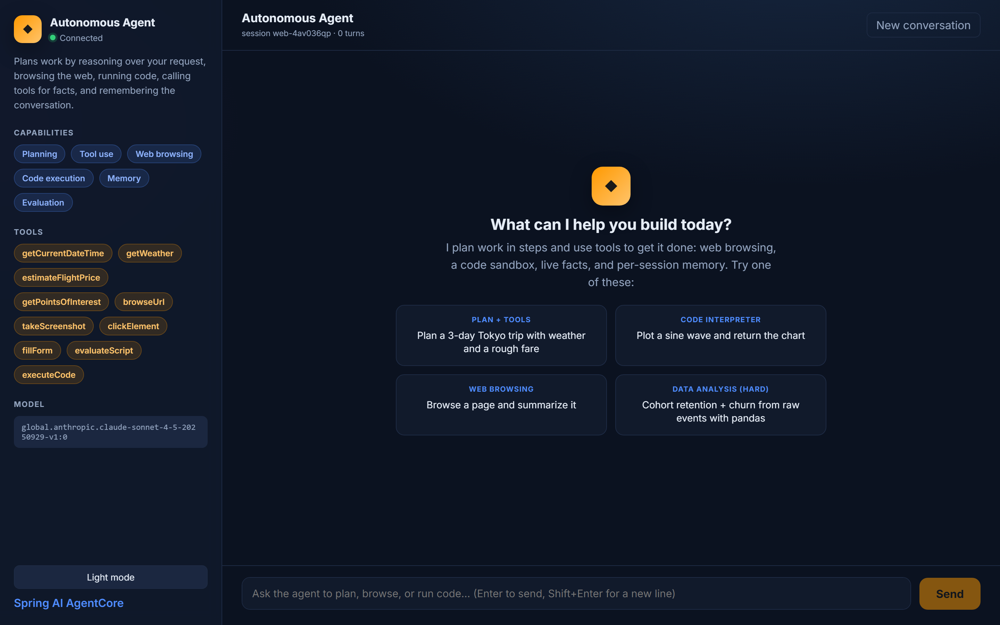

# Autonomous Agent, Amazon Bedrock + Spring AI + AgentCore

A production-grade autonomous AI agent written in Java with Spring Boot and a **React +
TypeScript UI**. It demonstrates the core agent capabilities, **planning, tool use, web
browsing, code execution, and memory**, on Amazon Bedrock, packaged to run on **Amazon
Bedrock AgentCore Runtime** using the
[`spring-ai-agentcore`](https://github.com/spring-ai-community/spring-ai-agentcore) SDK
(version **2.0.0**, Spring Boot 4.1, Spring AI 2.0, Java 21).

This is the companion code for the blog post *Building Autonomous AI Agents with Amazon
Bedrock and Spring AI (Java)*.

## What it shows

| Concern | How |
|---|---|
| Runtime entry point | `@AgentCoreInvocation` method exposed as `POST /invocations` |
| Streaming responses | `Flux<String>` streamed token-by-token to the UI and runtime |
| Layered design | `web` -> `service` -> (`tools`, `metrics`, `config`) separation |
| Tool use (planning) | `DateTimeTools` + `TravelTools` registered on the `ChatClient` |
| Managed browser tools | AgentCore Browser (`browseUrl`, `takeScreenshot`, `clickElement`, `fillForm`, `evaluateScript`) |
| Managed code interpreter | AgentCore Code Interpreter (`executeCode`) for Python/JS/TS with chart + file return |
| Artifact handling | Screenshots and generated charts surfaced to the UI as inline images / download links |
| Online evaluation | AgentCore Evaluations advisor scores responses via the Evaluate API (opt-in) |
| Conversation + long-term memory | `AgentCoreMemory` advisors scoped per session |
| Resilience | Resilience4j circuit breaker + retry + timeout around the model call |
| Validation + error handling | Bean Validation on DTOs, `@RestControllerAdvice` envelope |
| Observability | Micrometer domain metrics, `@Observed`, Prometheus endpoint |
| Twelve-factor config | `AgentProperties` bound from the environment |
| React UI | Streaming chat with Markdown/chart rendering and a capabilities/tools/model panel |
| Managed deployment | ARM64 container, modular Terraform (ECR / IAM / runtime) with examples + per-env tfvars |

## Architecture

The React UI calls the Spring Boot app through the AgentCore Runtime contract
(`POST /invocations`) or the UI endpoints. `AgentController` adapts transport, an optional
`GuardrailService` screens the prompt, and `AgentService` drives a Spring AI `ChatClient`
with local tools, managed Browser/Code Interpreter providers, AgentCore Memory advisors,
and a Resilience4j circuit breaker + retry around the Amazon Bedrock call.

## Project layout

```
autonomous-agent/
├── pom.xml
├── Dockerfile                          # linux/arm64 image for AgentCore Runtime
├── src/main/java/com/amazonaws/samples/agentcore/autonomous/
│   ├── AutonomousAgentApplication.java
│   ├── web/                            # AgentController (@AgentCoreInvocation + REST), GlobalExceptionHandler
│   ├── service/AgentService.java       # core agent logic (planning/tools/browser/code/memory + resilience)
│   ├── tools/                          # DateTimeTools, TravelTools
│   ├── metrics/AgentMetrics.java       # Micrometer domain metrics
│   ├── config/                         # AgentProperties, AgentCoreToolsConfig, ResilienceConfig, ObservabilityConfig, WebConfig
│   └── dto/                            # PromptRequest, ChatResponse, AgentInfo, ErrorResponse
├── src/main/resources/application.properties
├── terraform/                          # production-grade modular IaC
│   ├── main.tf  variables.tf  outputs.tf  versions.tf  backend.tf
│   ├── terraform.tfvars.example        # every variable documented
│   ├── README.md                       # architecture, run steps, remote state, tooling
│   ├── environments/{dev,prod}.tfvars
│   ├── examples/complete/              # runnable end-to-end example
│   └── modules/{ecr,iam,agentcore-runtime}/   # each with its own README + validated inputs
└── scripts/                            # create-memory, build-and-push, deploy, cleanup
```

The React front end lives next to this module in
[`../autonomous-agent-ui/`](../autonomous-agent-ui/README.md) and ships as its own nginx
image. To run everything (both agents, both UIs, and the landing page), see
[`../README.md`](../README.md).

## API

| Method & path | Purpose |
|---|---|
| `POST /invocations` | AgentCore Runtime contract (session id from headers) |
| `POST /api/chat` | Streaming chat for the UI (text stream, token-by-token) |
| `POST /api/chat/sync` | Aggregated reply for simple clients/tests |
| `GET /api/agent/info` | Agent name, capabilities, tools, and model (UI renders this) |
| `GET /ping`, `/actuator/**` | Health, metrics, Prometheus |

## Prerequisites

- Java 21+ and Maven 3.9+ (Spring Boot 4.1 / Spring AI 2.0 / AgentCore 2.0 require Java 21)
- Node.js 20+ (for the UI)
- An AWS account with Amazon Bedrock model access enabled (a model such as Claude Sonnet
  4.5, `global.anthropic.claude-sonnet-4-5-20250929-v1:0`)
- AWS CLI v2; Docker (ARM64) and Terraform >= 1.6 for deployment

## Run locally

You need **JDK 21** (Spring Boot 4.1 / Spring AI 2.0 / AgentCore 2.0 require it), Maven 3.9+,
Node 20+, and AWS credentials with Bedrock model access. Run with the `local` profile: it
starts the agent statelessly (no AgentCore Memory resource) and disables the managed Browser
and Code Interpreter tools, which need AWS-managed services (see Known issues below).

**Backend (port 8080)**

macOS / Linux:

```bash
export AWS_REGION=us-east-1
mvn spring-boot:run -Dspring-boot.run.profiles=local     # http://localhost:8080
```

Windows PowerShell:

```powershell
$env:AWS_REGION="us-east-1"
mvn spring-boot:run "-Dspring-boot.run.profiles=local"   # http://localhost:8080
```

**UI (port 5173, proxies /api to the backend on 8080)**

```bash
cd ../autonomous-agent-ui
npm ci
npm run dev            # http://localhost:5173
```

Open http://localhost:5173 and try a suggestion, for example *"Plan a 3-day trip to Tokyo and
tell me the weather"* or the hard *"Cohort retention + churn from raw events with pandas"*
prompt. Locally the agent writes and reasons through the code directly (the managed Code
Interpreter is off).

### Running both sample apps at once

The IDP agent runs on 8081 and its UI on 5174 locally, so both apps run side by side. The
landing page on 3000 links them. See [`../README.md`](../README.md) for the full local
stack, with or without Docker Compose.

### Without the UI (curl)

AgentCore Runtime requires session ids of at least 33 characters, so the examples use ids
of that length even locally.

```bash
curl -N -X POST http://localhost:8080/invocations \
  -H "Content-Type: application/json" \
  -H "X-Amzn-Bedrock-AgentCore-Runtime-Session-Id: demo-session-0000000000000000000001" \
  -d '{"prompt":"I am flying Seattle to Tokyo next month. Weather there and a rough fare?"}'
```

The `/api/chat` and `/api/chat/sync` requests also accept optional `guardrails` and `memory`
booleans (both default true), for example `{"prompt":"...","guardrails":true,"memory":false}`.
`test_requests.http` has a full multi-turn script.

> Deployed on AgentCore Runtime (or with `agent.managed-tools-enabled=true` and the managed
> services provisioned) the agent additionally browses the web and runs code in a sandbox.
> To enable cross-session memory locally, create a memory resource with
> `./scripts/create-memory.sh`, export `AGENTCORE_MEMORY_ID`, and run without the local profile.

## What you see



Once both processes are running, open http://localhost:5173. The screen has two parts:

- **Left sidebar:** the agent's live identity from `GET /api/agent/info`, a connection status
  dot, the capability chips (Planning, Tool use, Web browsing, Code execution, Memory,
  Evaluation), the registered tool names, the active Bedrock model, and a light/dark theme
  toggle.
- **Main panel:** a chat with feature-first suggestion cards. Type a prompt (or click a card)
  and the reply streams token-by-token with a typing caret. Assistant replies render Markdown,
  so code blocks are formatted and, when the managed tools are enabled, code-interpreter charts
  and browser screenshots appear inline as images. Use "New conversation" to rotate the session.

The composer accepts Enter to send (Shift+Enter for a newline) and auto-grows. Each turn is
screened by the input guardrail and scoped to a per-tab session id for memory.

## Using the AgentCore capabilities

The agent registers the full AgentCore 2.0 toolset on its `ChatClient`. The model decides
when to call each tool; you drive it with natural language.

### Web browsing (AgentCore Browser)

Tools: `browseUrl`, `takeScreenshot`, `clickElement`, `fillForm`, `evaluateScript`.
Screenshots are returned to the UI as inline images.

```properties
# application.properties
agentcore.browser.mode=${BROWSER_MODE:agentcore}   # "agentcore" (managed) or "local" (Chromium)
```

- `agentcore` (default): uses the managed AgentCore Browser service (needs AWS access).
- `local`: launches a local headless Chromium through Playwright for development. Install the
  browser binary once with `npx playwright install chromium`.

Try: *"Browse https://spring.io and summarize it in three bullets, then take a screenshot."*

### Code execution (AgentCore Code Interpreter)

Tool: `executeCode` runs Python, JavaScript, or TypeScript in a managed sandbox with
numpy/pandas/matplotlib preinstalled. Generated charts and files are returned to the UI
(charts render inline, other files as download links).

```properties
agentcore.code-interpreter.session-timeout-seconds=900
agentcore.code-interpreter.file-store-ttl-seconds=300
```

Try: *"Plot y = sin(x) for x in 0..2pi with matplotlib, save it as sine.png, and show me the chart."*

### Online evaluation (AgentCore Evaluations)

Opt-in. When enabled, an evaluation advisor scores each response through the Bedrock
AgentCore Evaluate API and records Micrometer metrics.

```properties
spring.ai.agentcore.evaluations.enabled=${EVALUATION_ENABLED:false}   # set true to enable
spring.ai.agentcore.evaluations.evaluator-ids=Builtin.Helpfulness
spring.ai.agentcore.evaluations.sample-rate=1.0
```

```bash
EVALUATION_ENABLED=true mvn spring-boot:run
```

Scores surface as `agentcore.evaluation.*` metrics on `/actuator/prometheus`.

### Region

`AgentCoreToolsConfig` pins the AgentCore data-plane clients (browser, code interpreter,
evaluations) to the same region as the chat model (`spring.ai.bedrock.aws.region`), so
startup is deterministic regardless of the ambient environment.

## Observability

- `GET /actuator/health`, `/actuator/metrics`, `/actuator/prometheus`
- Domain metrics: `agent.chat.requests`, `agent.chat.success`, `agent.chat.failure`,
  `agent.chat.fallback`, `agent.chat.duration`
- `@Observed` on the service produces a timer today and a trace span once a Micrometer
  tracing bridge (OTLP → AWS X-Ray) is added
- Structured JSON logs via `LOG_FORMAT=ecs`

## Build and test

```bash
mvn clean verify                                 # backend (offline resilience, tools, and metrics tests)
cd ../autonomous-agent-ui && npm ci && npm run build   # UI type-check + bundle
```

## Deploy with Terraform (modular)

Terraform is split into reusable, independently documented modules under
`terraform/modules/` (`ecr`, `iam`, `agentcore-runtime`) and composed in
`terraform/main.tf`, with per-environment values in `terraform/environments/`. See
`terraform/README.md` for the full architecture, remote-state (S3 + DynamoDB) setup,
`terraform.tfvars.example`, the runnable `terraform/examples/complete/` example, and the
tflint/checkov/pre-commit workflow. The one-command deploy creates the repo, builds and
pushes the image, then provisions the runtime:

```bash
# Optional cross-session memory
./scripts/create-memory.sh
export AGENTCORE_MEMORY_ID=<printed-id>

# One command: ECR -> image -> IAM + runtime
./scripts/deploy.sh dev          # dev | prod
```

Invoke the deployed runtime. The runtime uses IAM (SigV4) authentication, so call it through
the AWS CLI or an AWS SDK; the session id must be at least 33 characters:

```bash
RUNTIME_ARN=$(terraform -chdir=terraform output -raw runtime_arn)
aws bedrock-agentcore invoke-agent-runtime \
  --agent-runtime-arn "$RUNTIME_ARN" \
  --runtime-session-id "$(uuidgen)" \
  --content-type application/json \
  --cli-binary-format raw-in-base64-out \
  --payload '{"prompt":"Plan a 3-day Tokyo itinerary for me."}' \
  response.json && cat response.json
```

## Cleanup

AgentCore Runtime is consumption-priced: you pay per second for the CPU and memory the agent
uses, plus Bedrock tokens and a small amount of CloudWatch/ECR storage.

```bash
./scripts/cleanup.sh dev         # terraform destroy for the environment
# Memory is preserved by default; delete it explicitly when no longer needed:
aws bedrock-agentcore-control delete-memory --memory-id "$AGENTCORE_MEMORY_ID" --region us-east-1
```

## Security notes

- The example uses an **IAM-authenticated** runtime. For end-user-facing agents, add an
  OAuth2 (JWT) authorizer, Amazon Cognito works well, and derive the memory
  `conversationId` from the verified user identity so each user's history is isolated.
- The IAM execution role follows least privilege: ECR pull, scoped CloudWatch Logs, X-Ray,
  the `bedrock-agentcore` namespace metric, `bedrock:InvokeModel*`, and AgentCore Memory
  actions limited to your memory resource ARN.
- Restrict `agent.cors-allowed-origins` to your real UI origins in production.

## Known issues and gotchas

- **JDK 21 is mandatory.** AgentCore 2.0 / Spring Boot 4.1 will not build or run on Java 17.
  Point `JAVA_HOME` at a JDK 21 before running Maven.
- **Managed Browser and Code Interpreter tools are off in the local profile.** They call the
  AWS-managed AgentCore Browser and Code Interpreter services (not available on a laptop),
  and there is a Spring AI 2.0 parsing bug for multi-line code (see below). Locally the agent
  reasons through code itself. Enable them with `agent.managed-tools-enabled=true` only when
  those services are provisioned (or when deployed on AgentCore Runtime).
- **Playwright browser download.** The Browser starter can trigger a large Playwright browser
  download at startup. When running locally with the Browser tool enabled, set
  `PLAYWRIGHT_SKIP_BROWSER_DOWNLOAD=1` (agentcore mode talks to the remote browser over CDP and
  does not need local browser binaries).
- **Port clash with the IDP agent.** Both default to 8080. Run one of them on another port
  (this app stays on 8080; run IDP on 8081).

## License

Apache License 2.0
