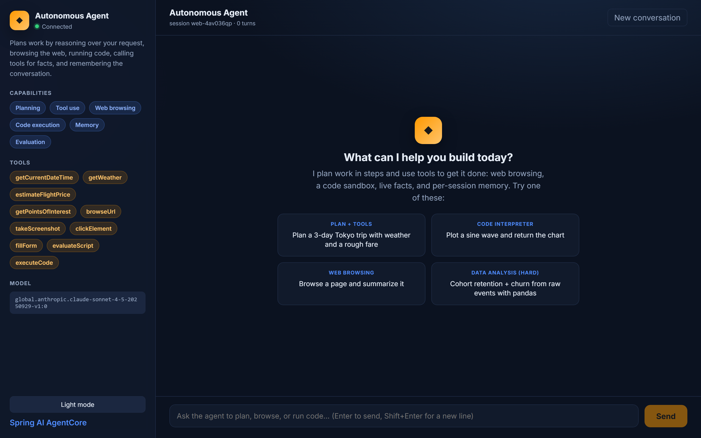

# Autonomous Agent UI

A React + TypeScript (Vite) chat interface for the autonomous agent backend. It streams
the reply token-by-token, renders rich Markdown (including the screenshots and charts the
agent produces), and showcases every AgentCore capability the backend exposes.



## Experience highlights

- **Streaming chat** read token-by-token from `POST /api/chat` with a live typing caret.
- **Rich Markdown rendering** of assistant replies through a small, dependency-free, XSS-safe
  renderer (`src/lib/markdown.ts`). It renders paragraphs, headings, lists, links, inline and
  fenced code, and, importantly, images.
- **Inline artifacts.** When the agent uses the code interpreter (matplotlib charts) or the
  browser (screenshots), the backend returns them as `data:` image URLs; the UI displays them
  inline. Generated files show up as download links.
- **Capability and tool panel** driven by `GET /api/agent/info` so the sidebar always reflects
  what the deployed agent can actually do (planning, web browsing, code execution, memory,
  evaluation) and which tools are registered.
- **Feature-first suggestions** that each exercise a different capability (planning + tools, the
  code interpreter, web browsing, and data analysis) so a first-time user sees the whole surface.
- **Light and dark themes** with a toggle, persisted to `localStorage`.
- **Per-session memory.** A stable session id is generated per browser tab and sent with every
  request so AgentCore Memory can scope conversation history. "New conversation" rotates it.
- **Quality-of-life touches:** auto-growing composer, Enter to send / Shift+Enter for a newline,
  copy-reply button, connection status, and a turn counter.

## Run in development

```bash
npm install
npm run dev      # http://localhost:5173
```

The dev server proxies `/api`, `/invocations`, and `/actuator` to the backend on
`http://localhost:8080` (override with `BACKEND_URL`), so there is no CORS in dev. Start the
Spring backend first (see the project README).

## Build

```bash
npm run build    # type-check + production bundle into dist/
npm run preview  # serve the built bundle locally
```

## Configuration

- `VITE_API_BASE`: base URL for the backend API. Leave empty to use the dev proxy or to serve
  the UI from the same origin as the backend (for example, behind nginx).
- `BACKEND_URL`: dev-proxy target used by `vite.config.ts`.

## Container

```bash
docker build -t autonomous-agent-ui .
docker run -p 8081:8080 autonomous-agent-ui
```

The image builds the static bundle and serves it with nginx, proxying `/api` to a `backend`
host (see `nginx.conf`).

## How it talks to the backend

| UI action | Endpoint |
|---|---|
| Load agent capabilities / tools / model | `GET /api/agent/info` |
| Send a message (streamed reply) | `POST /api/chat` (text stream) |

The streaming reply is read with the `fetch` + `ReadableStream` API in `src/api.ts`.

## Project structure

```
ui/src/
├── App.tsx                    # layout, streaming, theme, suggestions, session
├── api.ts                     # typed client (agent info + streaming chat)
├── lib/markdown.ts            # safe Markdown -> HTML (images, code, links, lists)
├── components/
│   ├── AgentInfoBar.tsx       # brand, status, capabilities, tools, model, theme toggle
│   └── ChatMessage.tsx        # user/assistant bubbles, Markdown, copy action
└── styles.css                 # design tokens + light/dark themes
```

## Try it

Ask one of the built-in suggestions, or:

- "Plot y = sin(x) with matplotlib and show me the chart." (code interpreter, returns a PNG)
- "Browse https://spring.io and summarize it." (browser tool)
- "Plan a 3-day Tokyo trip with weather and a rough fare." (planning + domain tools + memory)

## Security note (dependencies)

`npm audit` reports a moderate/high advisory in `esbuild` (pulled in transitively by Vite 5).
This advisory (GHSA-67mh-4wv8-2f99) affects only the **local Vite dev server**; it is not
present in the production bundle, which is prebuilt static files served by nginx (esbuild is
not in the runtime). The fix requires a breaking upgrade to Vite 7+, tracked as a separate
change so the sample stays stable. Do not run the dev server on an untrusted network. Run
`npm audit` in CI and upgrade Vite when you adopt the newer major.
