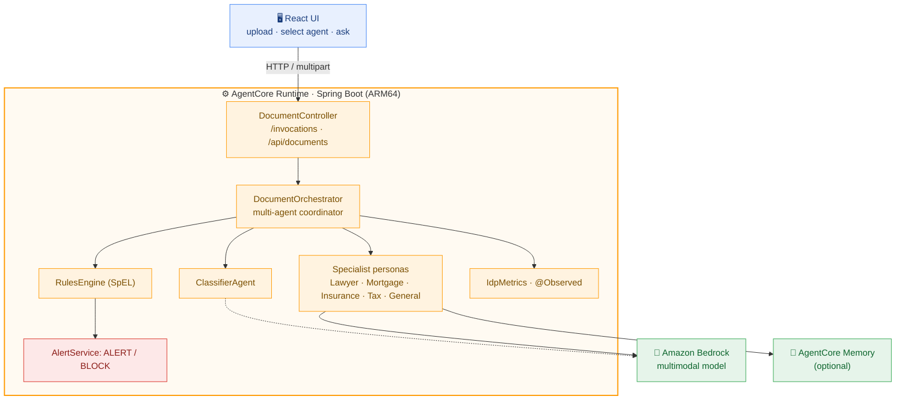
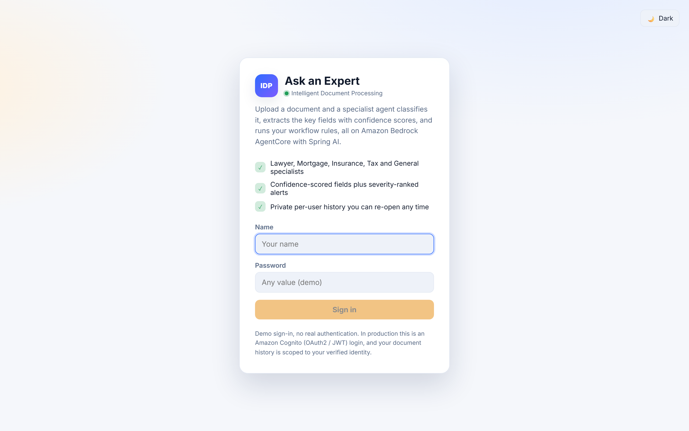
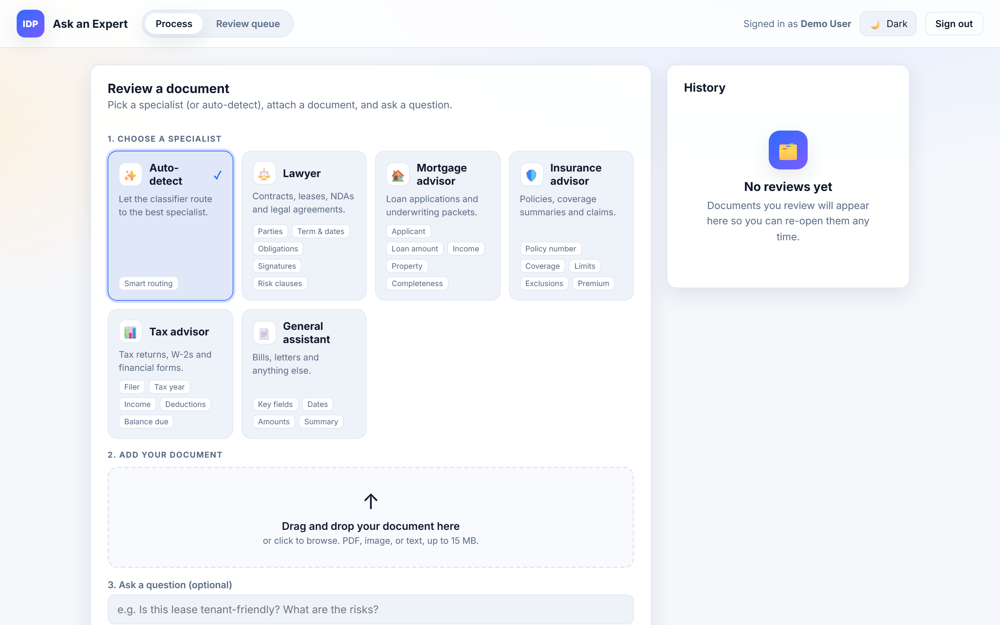

# Intelligent Document Processing (IDP) Agent

A production-grade, **multi-agent** Intelligent Document Processing system built on
**Amazon Bedrock**, **Spring AI**, and the
[**Spring AI AgentCore SDK**](https://github.com/spring-ai-community/spring-ai-agentcore)
(version **2.0.0**, Spring Boot 4.1, Spring AI 2.0, Java 21), with a **React UI**, a
configurable **workflow rules engine**, **alerting**, full **observability**,
**resilience**, and **production-grade modular Terraform**.

Upload a document (text, image, or PDF), pick a specialist persona (Lawyer, Mortgage,
Insurance, Tax, or General) or let the system auto-classify, optionally ask a question, and
get back a structured extraction plus any workflow alerts, for example, *"Lease is
unsigned, route to manual review."*

## What makes it production-grade

- **Multi-agent**: a classifier routes to specialist personas (Lawyer, Mortgage, Insurance,
  Tax, General), each with its own prompt and extraction focus.
- **Agents read files and answer**: multimodal, the model reads images/PDFs directly and
  can answer a free-text question about the document.
- **Intelligent rules / workflow engine**: SpEL rules in `application.yml` fire alerts
  (e.g. missing signature, low confidence, unsigned contract). Add rules with no code change.
- **Alerting**: ALERT/BLOCK rules dispatch through a pluggable `AlertService` (log + metric
  by default; swap in Amazon SNS, Slack, or email).
- **Resilience**: Resilience4j circuit breaker + retry with exponential backoff around the
  Bedrock call.
- **Observability**: Micrometer `@Observed` spans, domain metrics
  (`idp.documents.processed`, `idp.extraction.confidence`, `idp.alerts.sent`), Prometheus
  endpoint, structured JSON logs, OpenTelemetry-ready.
- **AgentCore Runtime contract** via the runtime starter; optional AgentCore Memory for
  cross-document session context.
- **Production-grade modular Terraform** (ecr / iam / agentcore-runtime) with per-module
  READMEs, input validation, `default_tags`, `terraform.tfvars.example`, and runnable
  examples (`examples/complete` for AgentCore Runtime, `examples/eks` for Kubernetes).
- **React + TypeScript UI**: branded login, persona picker, drag-and-drop upload with
  one-click samples, confidence bars, severity-coded alerts, per-user history, light/dark theme.

## Architecture

The full agentic reference architecture this system targets (numbered 1–11, request to grounded answer):


The system architecture as implemented in this repo:


And the decision flow one document takes through `DocumentOrchestrator.process()`:


The runtime flow in this repo:



## Project layout

```
idp-agent/
├── pom.xml
├── Dockerfile                      # linux/arm64 backend image
├── src/main/java/com/amazonaws/samples/agentcore/idp/
│   ├── IdpAgentApplication.java
│   ├── agent/                      # AgentType, DocumentAgent, AbstractDocumentAgent,
│   │   │                           #   DocumentContext, ClassifierAgent, LlmJson
│   │   └── specialist/             # Lawyer/Mortgage/Insurance/Tax/General agents
│   ├── service/DocumentOrchestrator.java
│   ├── rules/                      # IdpProperties, RulesEngine, RuleContext, RuleResult
│   ├── alert/                      # AlertService + LoggingAlertService
│   ├── metrics/IdpMetrics.java
│   ├── config/                     # Resilience, Observability, Web (CORS)
│   ├── dto/                        # DocumentRequest, ProcessedDocument, DocumentResult
│   └── web/DocumentController.java
├── src/main/resources/application.yml   # config + workflow rules
├── samples/                        # one PDF per persona (lease, mortgage, insurance, tax, utility)
├── terraform/                      # production-grade modular IaC
│   ├── main.tf  variables.tf  outputs.tf  versions.tf  backend.tf
│   ├── terraform.tfvars.example  README.md
│   ├── environments/{dev,prod}.tfvars
│   ├── modules/{ecr,iam,agentcore-runtime,eks-irsa,eks-workload}/   # each with its own README
│   └── examples/
│       ├── complete/               # runnable AgentCore Runtime deployment (primary path)
│       └── eks/                    # runnable Kubernetes deployment (VPC + EKS + IRSA + workload)
└── scripts/                        # create-memory, build-and-push(-eks), deploy(-eks), cleanup(-eks)
```

The React front end lives next to this module in
[`../idp-agent-ui/`](../idp-agent-ui/README.md) and ships as its own nginx image. To run
everything (both agents, both UIs, and the landing page), see [`../README.md`](../README.md).

## Prerequisites

- Java 21+ and Maven 3.9+ (Spring Boot 4.1 / Spring AI 2.0 / AgentCore 2.0 require Java 21)
- Node.js 20+ (for the UI)
- AWS account with Amazon Bedrock model access enabled (a multimodal model such as
  Claude Sonnet 4.5, `global.anthropic.claude-sonnet-4-5-20250929-v1:0`)
- AWS CLI v2; Docker (ARM64) and Terraform >= 1.6 for deployment

## Run locally

You need **JDK 21** (required by AgentCore 2.0 / Spring Boot 4.1), Maven 3.9+, Node 20+, and
AWS credentials with Bedrock model access. The `local` profile runs statelessly (no AgentCore
Memory resource) and pre-allows the UI dev-server origins for CORS.

The container listens on 8080 (the AgentCore Runtime contract port). Locally, run the IDP
backend on **8081** and its UI on **5174** so it sits alongside the autonomous-agent
(8080 / 5173); the UI dev server proxies to 8081 by default.

**Backend (port 8081)**

macOS / Linux:

```bash
export AWS_REGION=us-east-1
mvn spring-boot:run -Dspring-boot.run.profiles=local -Dspring-boot.run.arguments=--server.port=8081
```

Windows PowerShell:

```powershell
$env:AWS_REGION="us-east-1"
mvn spring-boot:run "-Dspring-boot.run.profiles=local" "-Dspring-boot.run.arguments=--server.port=8081"
```

**UI (port 5174, proxies /api to the backend on 8081)**

```bash
cd ../idp-agent-ui
npm ci
npm run dev            # http://localhost:5174 (proxies /api to http://localhost:8081)
```

Set `BACKEND_URL` to point the dev-server proxy somewhere else.

Open http://localhost:5174, sign in, choose the **Lawyer** persona, upload
`samples/lease-agreement.pdf`, and ask "Is this lease tenant-friendly, and is it signed?".
You should see a structured extraction, an unsigned-document **ALERT**, and the document
routed to the **Review queue** tab. See `samples/README.md` for one ready-to-use PDF per
persona and the question to ask.

> The UI calls the backend through a same-origin proxy, so CORS is not involved. If you
> call the backend directly from another origin, add it to `idp.cors.allowed-origins`.

### Without the UI (curl)

```bash
curl -X POST http://localhost:8081/api/documents \
  -F "agentType=LAWYER" \
  -F "question=Is this lease tenant-friendly, and is it signed?" \
  -F "file=@samples/lease-agreement.pdf;type=application/pdf"
```

Human review endpoints: `GET /api/review` (pending), `POST /api/review/{id}/resolve` with
`{"decision":"APPROVE","reviewer":"you","note":"..."}`. `test_requests.http` has ready-to-run
JSON and multipart examples.

## What you see

**1. Sign in** (demo auth, stored in the browser; replace with Amazon Cognito for production):



**2. Dashboard.** After signing in you land on the console:



- **Process / Review queue tabs** in the top bar. The Review queue tab shows a live badge with
  the number of documents awaiting a human decision.
- **Choose a specialist:** card-based persona picker (Auto-detect, Lawyer, Mortgage, Insurance,
  Tax, General), each card describing what that specialist extracts.
- **Upload:** a drag-and-drop zone with file validation plus one-click sample documents
  (the bundled PDFs), and an optional free-text question.
- **Results:** the classified document type, an overall confidence bar, the summary and answer,
  extracted fields each with a per-field confidence bar, workflow alerts sorted by severity, and
  a distinct "Needs human review" banner when the document was routed to the queue.
- **Review queue:** reviewers approve or reject each pending document with an optional note.
- **History:** a per-user list of processed documents you can re-open, all in light or dark theme.

## The workflow rules engine

Rules live in `application.yml` under `idp.rules`. Each has a SpEL `condition` evaluated
against the extraction (`documentType`, `confidence`, `validationIssues`,
`field('name')`, `missing('name')`). Add a rule, no code change:

```yaml
idp:
  rules:
    - id: legal-unsigned
      agentType: LAWYER        # ALL | LAWYER | MORTGAGE | INSURANCE | TAX | GENERAL
      condition: "field('signaturePresent') == 'false' || missing('signaturePresent')"
      severity: ALERT          # INFO | WARN | ALERT | BLOCK
      message: "Document appears unsigned, get all parties to sign before relying on it."
```

`ALERT` and `BLOCK` rules dispatch through `AlertService`; `BLOCK` also marks the document
blocked for manual review. SpEL rules are trusted operator configuration, not end-user input.

To send real alerts, provide your own `AlertService` bean (Amazon SNS, Slack, email); it
replaces the default `LoggingAlertService` automatically.

## Observability

- `GET /actuator/health`, `/actuator/metrics`, `/actuator/prometheus`
- Domain metrics: `idp.documents.processed{type,status}`,
  `idp.extraction.confidence{type}`, `idp.alerts.sent{severity,type}`,
  `idp.processing.duration{type}`
- `@Observed` on the orchestrator produces a timer today and a trace span once you add a
  Micrometer tracing bridge (OTLP → AWS X-Ray / OpenTelemetry collector)
- Structured JSON logs via `LOG_FORMAT=ecs`

## Deploy with Terraform (modular)

```bash
./scripts/build-and-push.sh                 # build + push ARM64 image to ECR
AGENTCORE_MEMORY_ID=<optional> ./scripts/deploy.sh dev   # dev | prod
```

Terraform is split into reusable, independently documented modules under
`terraform/modules/` and composed in `terraform/main.tf`, with per-environment values in
`terraform/environments/`. See `terraform/README.md` for the full architecture, remote
state (S3 + DynamoDB) setup, `terraform.tfvars.example`, the runnable
`terraform/examples/complete/` (AgentCore Runtime) and `terraform/examples/eks/`
(Kubernetes) examples, and the tflint/checkov/pre-commit workflow. Every module carries its
own README with validated inputs and outputs.

Invoke the deployed runtime. The runtime uses IAM (SigV4) authentication, so call it through
the AWS CLI or an AWS SDK; the session id must be at least 33 characters:

```bash
RUNTIME_ARN=$(terraform -chdir=terraform output -raw runtime_arn)
aws bedrock-agentcore invoke-agent-runtime \
  --agent-runtime-arn "$RUNTIME_ARN" \
  --runtime-session-id "$(uuidgen)" \
  --content-type application/json \
  --cli-binary-format raw-in-base64-out \
  --payload '{"agentType":"LAWYER","mimeType":"text/plain","content":"LEASE AGREEMENT between Landlord and Tenant ... (no signatures)","question":"Is this lease signed?"}' \
  response.json && cat response.json
```

## Deploy on Amazon EKS (alternative)

Prefer to run the agent on Kubernetes instead of AgentCore Runtime? The consolidated
example at `terraform/examples/eks` provisions everything with least privilege: a VPC, an
EKS cluster with Graviton (arm64) nodes, an **IRSA** role (IAM Roles for Service Accounts)
scoped to the pod's service account (Bedrock invoke + the AgentCore Memory resource only),
and a Deployment, Service, HPA, and namespace. No node-wide credentials. See
`terraform/examples/eks/README.md` for full details, including how to target an existing
cluster.

```bash
# 1. Build + push the arm64 image (creates the ECR repo if needed and records the
#    tag in terraform/examples/eks/image-version.txt for the deploy step)
TARGET_ARCH=arm64 ./scripts/build-and-push-eks.sh

# 2. Deploy (terraform init + apply) for an environment (dev | prod)
AGENTCORE_MEMORY_ID=<optional> ./scripts/deploy-eks.sh dev

# 3. Smoke test
aws eks update-kubeconfig --name idp-agent-dev --region us-east-1
kubectl -n idp get pods
kubectl -n idp port-forward svc/idp-agent-svc 8080:80
curl localhost:8080/ping
```

The Kubernetes provider authenticates to the cluster with a short-lived token from the AWS
provider, no kubeconfig wiring required. The Service defaults to an internet-facing load
balancer; switch it to an ALB Ingress with an ACM certificate for HTTPS.

## Cleanup

Tear down whichever path you deployed so you stop incurring cost:

```bash
# AgentCore Runtime path
./scripts/cleanup.sh dev        # terraform destroy (dev | prod)

# EKS path (tears down the full stack: app, cluster, node group, VPC, IRSA role)
./scripts/cleanup-eks.sh dev
```

Also delete any AgentCore Memory resource and ECR images you no longer need:

```bash
aws bedrock-agentcore-control delete-memory --memory-id <id> --region <region>
aws ecr delete-repository --repository-name <repo> --force --region <region>
```

AgentCore Runtime is consumption-priced (per-second CPU and memory actually used), so an idle
agent costs very little; your main variable cost is Bedrock token usage.

## Build and test

```bash
mvn clean verify                                  # backend (offline rules + agent-type tests included)
cd ../idp-agent-ui && npm ci && npm run build     # UI type-check + bundle
```

## Security notes

- Treat ID-card and financial fields as sensitive personal data downstream.
- The runtime uses IAM auth by default; add an OAuth2 (JWT) authorizer for user-facing use
  and derive the memory actor from the verified identity.
- Restrict `idp.cors.allowed-origins` to your real UI origins in production.

## Known issues and gotchas

- **JDK 21 is mandatory** (AgentCore 2.0 / Spring Boot 4.1). Point `JAVA_HOME` at a JDK 21.
- **CORS with the Vite dev proxy.** The dev server forwards the browser `Origin`, so the
  backend must allow the exact port the UI is served from. The `local` profile allows 5173,
  5174, and 4173. A 403 "Invalid CORS request" means the UI origin is not in
  `idp.cors.allowed-origins`.
- **Port clash with the autonomous agent.** Both default to 8080. Run IDP on 8081 (and its UI
  on 5174) when running both, as shown in Run locally.
- **Memory autoconfiguration.** Without the `local` profile and without a valid
  `AGENTCORE_MEMORY_ID`, startup fails with "MemoryId cannot be null or empty". Use the
  `local` profile for stateless local runs, or provide a real memory id.
- **Review queue is in-memory.** The human-review queue is per-instance and non-durable by
  design for the sample. Back it with DynamoDB or SQS for a scaled or durable deployment.

## License

Apache License 2.0
