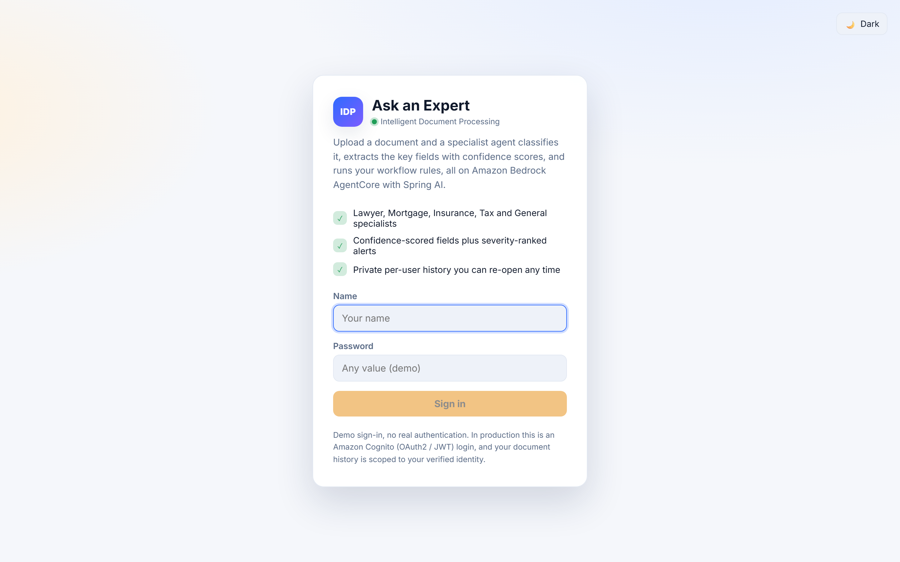
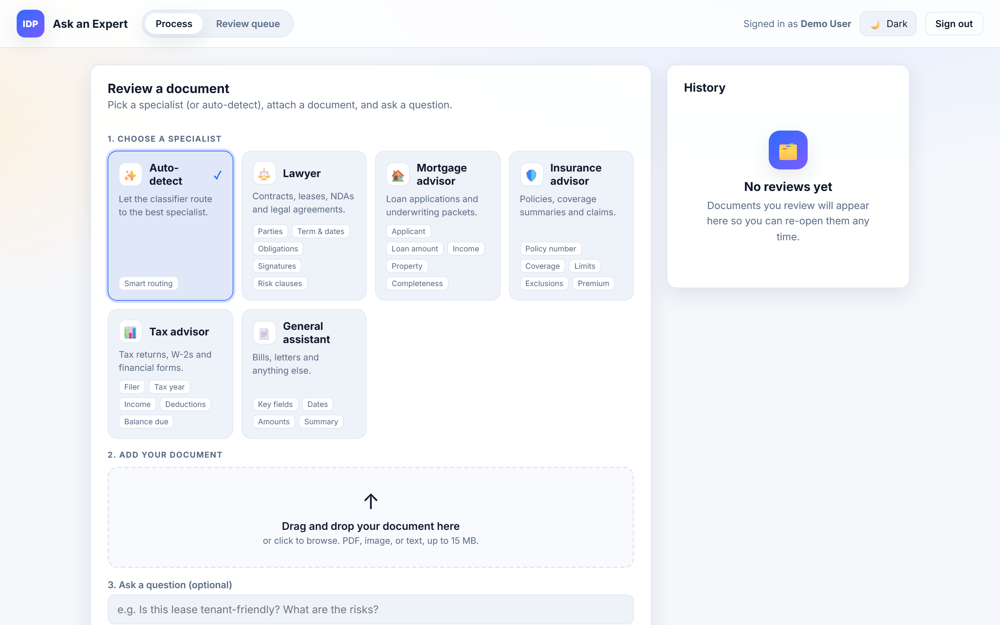

# Ask an Expert, IDP Agent UI

A polished Vite + React + TypeScript front end for the Intelligent Document Processing
(IDP) system. You sign in, pick a specialist persona (or let the app auto-detect one),
upload a document, and the backend classifies it, extracts the key fields with confidence
scores, and runs your workflow rules. The UI shows a clean summary, confidence bars,
severity-ranked alerts, and a private per-user history you can re-open any time.

The visual language (design tokens, light/dark theme, Inter + JetBrains Mono, gradient
brand mark, soft shadows, rounded cards, status dots, chips) matches the sibling
autonomous-agent UI for a consistent experience across the two sample apps.




## Experience and features

### Sign in

- Branded, gradient login screen with a clear value proposition and feature highlights.
- Lightweight demo auth: enter a name (password is cosmetic) and your session is stored in
  `localStorage`. There is no real authentication; in production this is an Amazon Cognito
  (OAuth2 / JWT) login and history is scoped to the verified identity.
- The light/dark theme toggle is available right on the login screen.

### Choose a specialist

A card-based persona picker renders one card per specialist returned by the backend, plus
an Auto-detect option:

- Auto-detect: the backend classifier routes the document to the best specialist.
- Lawyer: contracts, leases, NDAs and legal agreements (parties, term and dates,
  obligations, signatures, risk clauses).
- Mortgage advisor: loan applications and underwriting packets (applicant, loan amount,
  income, property, completeness).
- Insurance advisor: policies, coverage summaries and claims (policy number, coverage,
  limits, exclusions, premium).
- Tax advisor: tax returns, W-2s and financial forms (filer, tax year, income, deductions,
  balance due).
- General assistant: bills, letters and anything else (key fields, dates, amounts,
  summary).

The picker is a proper ARIA radio group, so it is fully keyboard navigable and screen
reader friendly.

### Upload a document

- Drag-and-drop zone with a click-to-browse fallback and keyboard activation.
- File validation: PDF, image (PNG or JPG), or text, up to 15 MB. Unsupported or oversized
  files show an inline error and are rejected before upload.
- Selected files show as a pill with the name and human-readable size, plus a Remove
  action.
- Use a sample document: one-click chips load real bundled PDFs (lease, mortgage
  application, insurance policy, tax return, utility bill) from `public/samples/`, preset
  the matching specialist and question, and submit immediately.
- Optional free-text question, for example "Is this lease tenant-friendly? What are the
  risks?".

### Processing state

While the backend works, an animated processing card shows a spinner, an indeterminate
progress bar, and shimmering skeleton lines, so it is always clear the request is running.

### Results

- Summary header with the specialist that handled the document and the classified document
  type.
- A blocked banner when a BLOCK-severity rule fires, and a low-confidence banner when the
  overall confidence is under 60 percent.
- Overall confidence bar (color-coded: green high, amber medium, red low) with accessible
  `progressbar` semantics.
- Document summary and, when a question was asked, a highlighted answer block.
- Extracted fields in a readable row layout: field name, value (with a graceful "Not found"
  for empties), and a per-field confidence bar.
- Validation issues list when the agent reports any.
- Workflow alerts sorted highest severity first, each with a severity badge, message,
  colored left border, and the rule id.
- Empty and low-confidence cases are handled gracefully rather than showing blank space.

#### Needs-human-review banner

When the backend routes a document to the human review queue, the result shows a distinct
"Needs human review" banner (accent-blue, separate from the red blocked banner and the
amber low-confidence banner). It lists the `reviewReasons` returned by the backend (for
example blocked, alerted, or low confidence) and explains that a person will approve or
reject the document. The banner is driven by the `needsReview`, `reviewId`, and
`reviewReasons` fields on `DocumentResult`.

### Review queue

The topbar has two views: Process (the upload and results workflow) and Review queue. The
Review queue tab shows a live badge with the number of documents currently awaiting a
decision. The count refreshes when the app loads, after each document is processed (a
freshly routed document bumps the badge immediately), and whenever the tab is opened.

The Review queue lists each pending item as a card showing:

- the specialist persona icon and name, and the classified document type,
- the document summary and an overall confidence bar,
- the reasons the item needs review,
- any workflow alerts (severity-sorted, same presentation as the results view),
- the time it entered the queue (relative, for example "5m ago").

A reviewer types an optional note and clicks Approve or Reject. The decision is sent to the
backend with the signed-in name as the reviewer; on success the item is removed from the
pending list, the badge count drops, and a short confirmation toast appears. Loading,
empty ("No documents awaiting review"), and error states are all handled, and the list uses
an `aria-live` region so screen readers announce changes as items resolve.

### History

- Per-user list of processed documents, persisted in `localStorage`, ordered newest first.
- Each entry shows the specialist icon, document type, file kind, filename, and relative
  time, plus alert and blocked indicators.
- Actions per entry: Open (re-render the full result), Document (re-open the original
  upload in a new tab when it was small enough to store), Share (copy a plain-text summary
  to the clipboard), and Delete. Clear all removes the whole history.
- An empty state invites the first review.

### Theme, responsiveness, accessibility

- Light/dark theme toggle persisted in `localStorage` and applied via `data-theme` on the
  `<html>` element; it also respects the OS `prefers-color-scheme` on first load.
- Responsive layout: the two-column dashboard collapses to a single column on narrow
  screens, and the persona grid reflows.
- Accessible by default: form labels, alt/aria text, `aria-live` status regions, focus-
  visible rings, keyboard-operable dropzone and persona cards, and a
  `prefers-reduced-motion` fallback that disables animations.

## Develop

```bash
npm install
npm run dev            # http://localhost:5173, proxies /api to http://localhost:8080
```

The dev server proxies `/api`, `/invocations`, and `/actuator` to the backend (override the
target with `BACKEND_URL`). Start the backend first (`mvn spring-boot:run` in the parent
`idp-agent` directory).

**Running alongside the autonomous-agent** (which uses 8080 / 5173): run this backend on 8081
and this UI on 5174 so the two do not collide:

```bash
BACKEND_URL=http://localhost:8081 npm run dev -- --port 5174    # http://localhost:5174
```

```powershell
# Windows PowerShell
$env:BACKEND_URL="http://localhost:8081"; npm run dev -- --port 5174
```

The IDP backend's `local` profile already allows the 5173, 5174, and 4173 origins for CORS.

## Build

```bash
npm run build      # type-checks (tsc -b) and bundles to dist/
npm run preview    # serve the production build locally
npm run lint       # type-check only (tsc --noEmit)
```

## Container

```bash
docker build -t idp-agent-ui .
docker run -p 8081:8080 idp-agent-ui
```

`nginx.conf` serves the SPA and proxies `/api/` to a `backend` host on port 8080. Point it
at your backend (Kubernetes service name, ECS service, or load balancer) at deploy time.

## Configuration

- `VITE_API_BASE` (build-time, read in `src/api.ts`): absolute API base URL. Leave empty to
  use the dev proxy or same origin (recommended when nginx fronts both UI and API).
- `BACKEND_URL` (dev only, read in `vite.config.ts`): target for the dev-server proxy.
  Defaults to `http://localhost:8080`.

Copy `.env.example` to `.env` to set these locally.

## Backend contract

The UI talks to the Spring `DocumentController` and mirrors its DTOs in `src/api.ts`.

| UI action | Request | Endpoint | Response |
| --- | --- | --- | --- |
| Load specialist list | `GET` | `/api/agents` | `string[]` of agent types (`LAWYER`, `MORTGAGE`, `INSURANCE`, `TAX`, `GENERAL`) |
| Review a document | `POST` multipart (`file`, optional `agentType`, `question`, `sessionId`) | `/api/documents` | `DocumentResult` |
| Load pending reviews | `GET` | `/api/review` | `ReviewItem[]` (pending, newest first) |
| Load all reviews | `GET` | `/api/review/all` | `ReviewItem[]` (any status) |
| Resolve a review | `POST` JSON `{ decision: "APPROVE" \| "REJECT", reviewer, note? }` | `/api/review/{id}/resolve` | updated `ReviewItem` |

`DocumentResult` shape (see `src/api.ts`):

- `agentType`: specialist that handled the document.
- `extraction`: `ProcessedDocument` with `documentType`, `summary`, `answer`,
  `fields[]` (each `name`, `value`, `confidence` 0.0 to 1.0), `confidence`, and
  `validationIssues[]`.
- `alerts`: `RuleResult[]`, each with `ruleId`, `severity` (`INFO`, `WARN`, `ALERT`,
  `BLOCK`), and `message`.
- `blocked`: true when a BLOCK-severity rule fired.
- `needsReview`: true when the document was routed to the human review queue.
- `reviewId`: id of the queued review item, or `null` when no review is needed.
- `reviewReasons`: `string[]` explaining why it was routed to review (empty when none).

`ReviewItem` shape (see `src/api.ts`):

- `id`: stable identifier used to resolve the item.
- `agentType`: specialist that processed the document.
- `conversationId`: session the document belongs to.
- `extraction`: the `ProcessedDocument` under review.
- `alerts`: `RuleResult[]` that fired.
- `reasons`: `string[]` explaining why it needs review.
- `status`: `PENDING`, `APPROVED`, or `REJECTED`.
- `reviewer` / `reviewerNote`: who resolved it and any note (null while pending).
- `createdAt` / `resolvedAt`: ISO-8601 instants (`resolvedAt` is null while pending).

The review queue calls `fetchPendingReviews()` on open and after each resolve,
`resolveReview(id, decision, reviewer, note)` to record a decision, and reports the pending
count back to the dashboard for the tab badge. `fetchAllReviews()` is also exported for
future history views.

The UI sends the signed-in name as `sessionId` so the backend can scope the conversation.
API calls and response handling are unchanged from the original UI; only presentation and
interaction were elevated.

## Project layout

```
src/
  api.ts               Typed backend client (mirrors the Java DTOs)
  personas.ts          Presentation metadata for each specialist
  samples.ts           Bundled sample PDFs wired to the upload path
  App.tsx              Auth + theme shell
  main.tsx             React entry point
  styles.css           Design tokens and component styles
  lib/
    auth.ts            Demo localStorage session
    history.ts         Per-user document history in localStorage
    theme.ts           Persisted light/dark theme
  components/
    Login.tsx          Branded sign-in screen
    Dashboard.tsx      Main layout and data flow
    PersonaPicker.tsx  Specialist card picker (ARIA radio group)
    UploadForm.tsx     Drag-and-drop upload, validation, samples
    ProcessingCard.tsx Animated loading state
    ResultView.tsx     Summary, fields, confidence, alerts
    ConfidenceBar.tsx  Accessible color-coded confidence bar
    AlertsList.tsx     Severity-sorted workflow alerts
    HistoryPanel.tsx   Per-user history with re-open and clear
    ReviewQueue.tsx    Human-in-the-loop review queue (approve / reject)
    ThemeToggle.tsx    Light/dark switch
public/
  samples/             Real sample PDFs served at /samples/*.pdf
```

## Security note (dependencies)

`npm audit` reports a moderate/high advisory in `esbuild` (pulled in transitively by Vite 5).
This advisory (GHSA-67mh-4wv8-2f99) affects only the **local Vite dev server**; it is not
present in the production bundle, which is prebuilt static files served by nginx (esbuild is
not in the runtime). The fix requires a breaking upgrade to Vite 7+, tracked as a separate
change so the sample stays stable. Do not run the dev server on an untrusted network. Run
`npm audit` in CI and upgrade Vite when you adopt the newer major.
